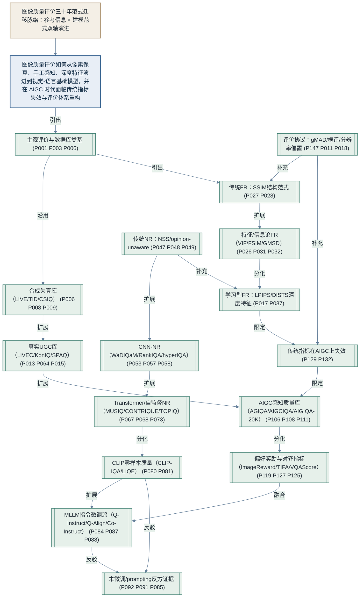

# 图像质量评价三十年：从像素保真到人类偏好与生成语义的范式迁移

**候选中文题目（≤20 汉字）**：
1. 图像质量评价研究进展：从像素保真到生成偏好（18 字）
2. 图像质量评价三十年：范式演进与前沿挑战（17 字）
3. 从 SSIM 到 MLLM：图像质量评价的范式迁移（18 字）

## 一、核心结论

本文回答的核心问题是：图像质量评价（Image Quality Assessment, IQA）走过了一条怎样的技术路线，在 2023 年以后为什么被生成式人工智能（AIGC）重写，以及今天这个领域的共识、分裂与空白分别在哪里。总答案是：IQA 的主线不是"哪个指标更准"的连续改良，而是两次范式迁移——第一次（2004 年前后）从像素误差（MSE/PSNR）转向人眼感知建模（SSIM 为代表的结构/特征/信息论指标），第二次（2023 年前后）从"预测失真物理"转向"预测人类偏好与语言化判断"（CLIP/MLLM 为代表的基础模型路线）。两次迁移之间，深度神经网络既改变了无参考（NR）指标的训练方式，也让"参考图像"这一前提本身被重新审视。传统保真指标在 AIGC 上的系统性失效（ImagenHub 中多数自动指标与人类相关性低于 0.2）是第二次迁移最直接的证据。下文按"主观评价与数据库—传统客观指标—NR-IQA—CLIP/MLLM—AIGC—评价协议"六条线展开。

1. **主观评价是整个领域的地基，而地基本身在过去十年被重铺。** 从 ITU-R BT.500（ITU-R，2019，P001）与 VQEG（2003，P003）确立"以主观数据为 ground truth、用相关系数评估模型"的范式，到 LIVE（Sheikh et al.，2006，P006）、TID2013（Ponomarenko et al.，2015，P008）、CSIQ（Larson and Chandler，2010，P009）等合成失真库，再到 LIVEC（Ghadiyaram and Bovik，2017，P013）、KonIQ-10k（Hosu et al.，2020，P064）、SPAQ（Fang et al.，2020，P015）等真实 UGC 库，数据库的失真来源从人工合成走向实拍、再走向 AI 生成。
2. **SSIM 是 FR 指标的范式原点，其后的手工特征路线是同一范式内的工程改良。** Wang et al.（2004，P027）用亮度、对比度、结构三分量的局部乘积替代逐点误差；FSIM（Zhang et al.，2011，P031）、GMSD（Xue et al.，2014，P032）、VSI（P033）、HaarPSI（Reisenhofer et al.，2018，P034）在效率、鲁棒性、池化策略上改进，但都未脱离"局部感知特征 + 池化"的框架。
3. **FR 指标的第二次跃迁来自深度特征。** Zhang et al.（2018，P017）在 BAPPS 上证明预训练深度特征的线性距离大幅超越经典度量；Ding et al.（2022，P037，DISTS）进一步把结构相似与纹理相似显式分离，纠正了深度特征对纹理重采样过度敏感的问题；LASI（Severo et al.，2024，P040）则反方向证明，无需深度网络、仅用像素域线性预测嵌入也能逼近 LPIPS 级性能。
4. **NR-IQA 经历了 NSS、CNN、Transformer/自监督三代，其核心矛盾始终是"泛化"。** NSS 派（BRISQUE，P047；NIQE，P048；IL-NIQE，P049）证明无需大规模主观标注即可评分；CNN 派（Kang et al.，2014，P053；Bosse et al.，2018，P057；Liu et al.，2017，P058）用监督学习把精度推高；Transformer/自监督派（MUSIQ，P067；CONTRIQUE，P068；TOPIQ，Chen et al.，2024，P073）把主攻方向转向跨库、跨失真类型的泛化。
5. **CLIP/MLLM 路线在 2023–2024 年同时给出了"零样本可行"与"未微调不行"两个相反结论。** CLIP-IQA（Wang et al.，2023，P080）与 LIQE（Zhang et al.，2023，P081）证明视觉-语言先验可直接用于质量打分；但系统 prompting 研究（Wu et al.，2024b，P092）发现未微调 MLLM 只会输出模板化描述，Q-Bench+（Zhang et al.，2024，P085）在 24 个 MLLM 中仅见 GPT-4V 成对比较超过单图。Q-Future 系列的指令微调工作（Wu et al.，2024，Q-Instruct P084 / Q-Align P087 / Co-Instruct P088）则证明微调后可以反超专用模型。
6. **传统 IQA 指标在 AIGC 上不是"还不够好"，而是评价对象本身变了。** ImagenHub（Ku et al.，2024，P129）统一评测约 30 个模型后发现，除主体驱动生成任务外，多数自动指标与人类判断的 Spearman 相关性低于 0.2；Ghildyal et al.（2024，P132）从概念上指出，既有 IQA 度量的是对参考图的"重建保真"，而不是对"生成伪影与语义对齐"的评价。
7. **AIGC 质量评价已经分裂为两套并行体系。** 一套以感知质量为主（AGIQA-1K P106、AGIQA-3K P107、AIGCIQA2023 P108、AIGIQA-20K P111），另一套以人类偏好与文图对齐为主（ImageReward P119、HPS v2 P120、Pick-a-Pic P122、TIFA P127、VQAScore P125、VIEScore P131）。前者沿用 MOS 与 SROCC 范式，后者用成对偏好、奖励模型与免训练 MLLM 评判，二者尚未统一。

## 二、研究范围与方法

本综述基于 150 篇经核验文献（A 级 93 篇、B 级 38 篇、C 级 19 篇；2023–2026 年文献 76 篇，占 50.7%），覆盖六个分支：主观评价与数据库（B1，25 篇）、传统 FR/RR 与学习型 FR（B2，22 篇）、NR-IQA（B3，36 篇）、CLIP/MLLM（B4，25 篇）、AIGC 质量评价（B5，32 篇）、综述与评价协议（B6，19 篇）。检索工具为学术检索与网络摘要页精读；关键词组围绕 subjective database、SSIM/LPIPS/DISTS、no-reference/BIQA、CLIP/MLLM IQA、AI-generated image quality、T2I alignment benchmark 六条线展开；时间范围重点为 2023–2026，同时保留 2003–2022 年的奠基性文献以保证脉络连续。纳入标准为：与图像（含屏幕、HDR、CGI、AIGC）质量的主观或客观评价直接相关、且经多源核验存在；排除标准为：纯视频/3D IQA（仅作交叉参考）、无法核验存在性的条目（如 GeoTrp、MP-IQDF、DiffusionGIQA、T2IQA-1M 已确认不存在）、以及仅为命名误传的工作（如 ChatIQA 经检索确认无同名 IQA 论文）。所有引文为摘要层概括，未读全文；摘要中明确给出的少量性能数字（如 KonCept512 在 LIVEC 上 SROCC 0.825）均标注"摘要层"，其余具体 SROCC/PLCC 数值一律不转引。

## 三、文献多维地图

| 主题 | 支持文献数 | 代表文献 | 争议 / 反对 | 研究空白 / 后续价值 |
|---|---:|---|---|---|
| A. 主观评价方法与质量数据库 | 23 篇 | Sheikh et al.（2006，P006）；Ponomarenko et al.（2015，P008）；Ghadiyaram and Bovik（2017，P013）；Hosu et al.（2020，P064）；Fang et al.（2020，P015） | 众包在线 vs 实验室受控的代表性之争；MOS 平均掩盖观察者个体差异（P023） | VOS、HDR、屏幕内容、高分辨率等新库的客观模型迁移研究少 |
| B. 传统 FR/RR 客观指标 | 12 篇 | Wang et al.（2004，P027）；Sheikh and Bovik（2006，P026）；Zhang et al.（2011，P031）；Xue et al.（2014，P032）；Soundararajan and Bovik（2012，P035） | 手工特征是否已被深度特征取代的路线之争 | RR 半参考方向 2023 年后几乎无新指标 |
| C. 学习型感知 FR 指标 | 8 篇 | Zhang et al.（2018，P017）；Ding et al.（2022，P037）；Ding et al.（2021，P038）；Liao et al.（2022，P039）；Severo et al.（2024，P040） | 深度特征距离的纹理敏感性（DISTS 修正） | 基础模型/VLM 作 FR 骨干的新指标 2025–2026 尚未成型 |
| D. 传统 NR/NSS 方法 | 9 篇 | Moorthy and Bovik（2010，P044）；Mittal et al.（2012，P047）；Mittal et al.（2013，P048）；Zhang et al.（2015，P049）；Ye et al.（2012，P050） | opinion-unaware 与 opinion-aware 的边界 | NSS 先验与深度特征的融合刚起步（P077） |
| E. CNN 时代 NR-IQA | 13 篇 | Kang et al.（2014，P053）；Bosse et al.（2018，P057）；Liu et al.（2017，P058）；Su et al.（2020，P061）；Ma et al.（2017，P055） | 跨库泛化与库内高分的矛盾 | 合成→真实失真的迁移机制仍未完全解释 |
| F. Transformer/自监督 NR-IQA | 11 篇 | Ke et al.（2021，P067）；Madhusudana et al.（2022，P068）；Yang et al.（2022，P069）；Saha et al.（2023，P071）；Chen et al.（2024，P073） | 原生分辨率、多尺度、语义引导哪条路径更优尚无定论 | 面向真实部署域的外部效度评测不足 |
| G. CLIP/MLLM 质量评价 | 25 篇 | Wang et al.（2023，P080）；Zhang et al.（2023，P081）；Wu et al.（2024，P084/P087/P088）；Wu et al.（2024b，P092）；Zhu et al.（2024，P089） | 微调派 vs 未微调派直接对立；CLIP 特征是否最优存疑 | 分数校准、离散 token 语义混淆尚无公认解法 |
| H. AIGC 主观数据库 | 13 篇 | Zhang et al.（2023，P106）；Li et al.（2023，P107）；Wang et al.（2023，P108）；Li et al.（2024，P111）；Qian et al.（2025，P115） | 单维质量 vs 多维（真实性/对应性/美学）标注之争 | 局部编辑、AI 增强 UGC、广告传播等场景刚起步 |
| I. 偏好奖励模型与对齐指标 | 10 篇 | Xu et al.（2023，P119）；Kirstain et al.（2023，P122）；Hu et al.（2023，P127）；Huang et al.（2023，P128）；Ku et al.（2024，P129/P131） | 传统自动指标与人类相关性 <0.2 的失效证据 | 感知质量与偏好分的统一框架尚未出现 |
| J. 评价协议与综述定位 | 14 篇 | Sheikh et al.（2006，P006）；Ma et al.（2016，P147）；Ma et al.（2017，P011）；Zhai and Min（2020，P135）；方玉明等（2021，P142）；鄢杰斌等（2022，P143） | gMAD 暴露标准库区分度不足 | 目标期刊 2022 年后无全景 IQA 综述，定位窗口明确 |

整体分布上，证据最密集的是 CLIP/MLLM（25 篇）与 AIGC 数据库（13 篇）两个 2023 年后的新板块，传统 FR/RR（12 篇）与 NSS（9 篇）作为奠基仍有充分 A 级文献支撑；明显稀疏的是 RR 半参考方向、HDR/屏幕等新库的迁移评测、以及观察者个体差异的替代范式。

## 四、研究视角与本文结构

本综述沿两条正交的轴组织材料。第一条轴是**参考信息可用性**：全参考（FR，需要完整参考图）、半参考（RR，只需部分参考信息）、无参考（NR，不需要参考图）。这条轴由 Wang and Bovik（2009，P024）的立场论文、Soundararajan and Bovik（2012，P035）的 RRED、以及整个 NSS 传统共同划定，是 IQA 领域沿用二十年的分类法；它互斥且完备——任何客观指标在给定任务下必居其一。第二条轴是**感知建模范式**：手工感知（HVS/NSS 先验）、CNN 学习、Transformer/自监督、视觉基础模型（CLIP/MLLM）。这条轴刻画的是"模型从哪里获得质量判断能力"——从人眼系统先验，到大规模 MOS 标注，到自监督预训练，再到通用视觉-语言先验。两条轴交叉成一张地图：传统 FR 指标落在"手工感知 × FR"格子，LPIPS/DISTS 落在"学习特征 × FR"格子，BRISQUE/NIQE 落在"手工感知 × NR"格子，MUSIQ/TOPIQ 落在"Transformer × NR"格子，Q-Align/VIEScore 落在"基础模型 × FR/NR 边界"格子。按此组织的好处是：每一次范式迁移都表现为地图上一条新列的兴起，而不是对旧格子的简单否定；同时，地图上的空格（如"基础模型 × RR"、"手工感知 × AIGC"）直接就是开放问题。下文主题章节即按此地图从左到右、从上到下展开。

## 五、核心逻辑图

下图以核心研究问题为根节点，按「参考信息可用性 × 建模范式」双轴串起 IQA 三十年研究脉络：NSS→CNN→Transformer→CLIP/MLLM 的范式扩展与分化、传统 FR 指标在 AIGC 上的失效限定，以及 MLLM 微调派与未微调派之间的争论。

## 六、主题章节

### （一）主观评价方法论与标准

*本节文献：ITU-R（2019，P001）；ITU-T（1996，P002）；VQEG（2003，P003）；Mantiuk et al.（2012，P004）；Ribeiro et al.（2011，P005）；Lou et al.（2024，P023）*

本节是整个综述的地基，回答"主观质量数据从哪里来、它凭什么作为客观模型的 ground truth"。IQA 领域的方法论文源头是两份 ITU 标准：ITU-R BT.500（P001）规定电视图像的主观测试条件、刺激方法与评分量表，ITU-T P.910（P002）规定多媒体应用的 ACR 等绝对类别评分方法。二者共同奠定了 MOS（Mean Opinion Score）这一贯穿全领域的评分范式。VQEG（2003，P003）的 FRTV Phase II 报告则第一次用多实验室统一数据大规模验证客观模型与主观分数的关系，把"用 SROCC/PLCC 等相关系数衡量模型"变成领域默认评测协议。

在方法层面，一个持续被讨论的问题是"用哪种主观刺激方式"。Mantiuk et al.（2012，P004）系统比较单刺激、双刺激、强制选择成对比较与相似性判断四种方法，结论是成对比较测量方差最小、结果最准确且在中等样本量下最省时；这一结论后来直接被 PIPAL（Gu et al.，2020，P016）的 Elo 评分制、以及 AIGC 时代 Pick-a-Pic、ImageReward 等偏好数据集采纳，是"从绝对分到成对偏好"这一转向在方法论上的先声。与众包相关，Ribeiro et al.（2011，P005）的 crowdMOS 证明在线平台配合恶意评分过滤后，主观结果准确可重复；LIVEC 与 KonIQ-10k 正是这条路线的规模化产物。值得注意的是，主观范式本身在 2024 年仍在被反思：Lou et al.（2024，P023）提出观点分数方差（VOS）基准，指出 MOS 在观察者间意见分歧大时代表性下降——这等于在 MOS 范式建立二十年之后，重新质疑"一个平均分能否代表质量"。

| 主观方法 | 刺激方式 | 典型规模 | 代表数据库 |
|---|---|---|---|
| 实验室受控 ACR/DSCQS | 单/双刺激绝对评分 | 数十名观察者 | LIVE（P006）、TID2013（P008） |
| 在线众包 MOS | 单刺激绝对评分 + 过滤 | 数千名在线工作者 | LIVEC（P013）、KonIQ-10k（P064） |
| 成对比较/Elo | 强制选择两两偏好 | 百万级判断 | PIPAL（P016）、BAPPS（P017） |
| 成对偏好数据集 | 真实用户两两选择 | 数十万至百万对 | ImageReward（P119）、Pick-a-Pic（P122） |

> **小结**：主观评价的方法论主线是"从受控实验室到大规模众包、从绝对分到成对偏好"，而 MOS 作为单一指标的代表性在 2024 年后开始被 VOS 等工作正式反思。

### （二）质量数据库谱系：从合成失真到真实 UGC 与新场景

*本节文献：Sheikh et al.（2006，P006）；Ponomarenko et al.（2009，P007）；Ponomarenko et al.（2015，P008）；Larson and Chandler（2010，P009）；Jayaraman et al.（2012，P010）；Ma et al.（2017，P011）；Lin et al.（2019，P012）；Ghadiyaram and Bovik（2017，P013）；Virtanen et al.（2015，P014）；Fang et al.（2020，P015）；Gu et al.（2020，P016）；Zhang et al.（2018，P017）；Wiedemann et al.（2023，P018）；Fang et al.（2023，P019）；Liu et al.（2024a，P020）；Venkataramanan and Bovik（2024，P021）；Liu et al.（2024b，P022）；Hosu et al.（2020，P064）*

数据库的演进史就是 IQA 的对象扩展史。第一代是**合成失真库**：LIVE（Sheikh et al.，2006，P006）用 29 幅参考图施加 JPEG、JP2K、噪声、模糊等失真类型，获得约 25000 次人类判断；TID2008（P007）与 TID2013（P008）把失真类型扩展到 24 种、并由五国 985 名观察者收集 MOS；CSIQ（Larson and Chandler，2010，P009）则伴随提出了 HVS 的检测式/外观式双策略模型。这类库的共同特点是失真可控、类型已知，因此成为 FR 指标的天然试验场；LIV-MD（Jayaraman et al.，2012，P010）进一步把对象扩展到多重失真叠加。

第二代是**大规模与免主观评分库**。Waterloo Exploration（Ma et al.，2017，P011）面对 94880 幅失真图无法逐图打分的现实，改用原始/失真可分性（D-test）、列表排序一致性（L-test）、成对偏好一致性（P-test）三种免 MOS 的隐式测试准则；KADID-10k（Lin et al.，2019，P012）则以 81 幅原图×25 种失真×5 等级的结构配合众包，另以 70 万幅无标注的 KADIS-700k 支持弱监督学习。第三代是**真实/UGC 库**：LIVEC（Ghadiyaram and Bovik，2017，P013）首次把对象换成 1162 幅移动设备实拍图并由 8100 余名在线观察者评分；CID2013（Virtanen et al.，2015，P014）按 79 种相机设备采集并附清晰度/颗粒度等分项评分；SPAQ（Fang et al.，2020，P015）进一步为 11125 幅手机摄影图附 5 类属性分与 EXIF。KonIQ-10k（Hosu et al.，2020，P064）以 10073 幅图、120 万条评分成为深度 BIQA 时代的事实标准。

近两年的新库则沿三个方向继续扩展：一是**感知恢复与偏好**，PIPAL（Gu et al.，2020，P016）首次纳入 GAN 恢复输出并发现现有 IQA 方法无法公平评价 GAN 算法，BAPPS（Zhang et al.，2018，P017）把对象设为人类感知相似性判断；二是**分辨率与新显示**，KonX（Wiedemann et al.，2023，P018）首次通过实验分离出分辨率变化引起的主观标签漂移与客观方法尺度偏置，HDRC（Liu et al.，2024a，P020）纳入 VVC 压缩失真 HDR 图，LIVE-TMHDR（Venkataramanan and Bovik，2024，P021）扩展到色调映射 HDR 视频；三是**相机系统与 CGI**，SQAD（Fang et al.，2023，P019）以六维客观准则建立相机质量基准，CGIQA-6k（P074）则把对象换成 in-the-wild 计算机图形图像。Liu et al.（2024b，P022）的 HDR 综述总结道，HDR 库的规模与多样性、以及通用感知映射方法仍是两个主要改进方向。

| 数据库代际 | 代表 | 失真来源 | 主观规模 | 对 IQA 的意义 |
|---|---|---|---|---|
| 合成失真 | LIVE（P006）、TID2013（P008）、CSIQ（P009） | 人工施加 5–24 种 | 数千至数万次 | FR 指标的标准试验场 |
| 大规模/免 MOS | Waterloo（P011）、KADID-10k（P012） | 人工合成 | 70 万图/免 MOS | 弱监督与隐式评测范式 |
| 真实 UGC | LIVEC（P013）、KonIQ-10k（P064）、SPAQ（P015） | 实拍真实失真 | 120 万条评分 | 深度 BIQA 事实标准 |
| 新场景 | KonX（P018）、HDRC（P020）、CGIQA-6k（P074） | 跨分辨率/HDR/CGI | 千级 | 暴露传统库外失效 |

> **小结**：数据库的扩展轨迹（合成→真实 UGC→HDR/CGI/AIGC）每次都迫使客观指标重新证明自己，KonX 揭示的标签漂移与 PIPAL 揭示的 GAN 评价失效是两个最典型的"库外失效"案例。

### （三）传统全参考指标：从像素误差到结构与特征

*本节文献：Wang and Bovik（2009，P024）；Sheikh et al.（2005，P025）；Sheikh and Bovik（2006，P026）；Wang et al.（2004，P027）；Wang et al.（2003，P028）；Wang and Simoncelli（2005，P029）；Wang and Li（2011，P030）；Zhang et al.（2011，P031）；Xue et al.（2014，P032）；Zhang et al.（2014，P033）；Larson and Chandler（2010，P009）；Reisenhofer et al.（2018，P034）*

传统 FR 指标的共同出发点是 Wang and Bovik（2009，P024）的立场性判断：MSE/PSNR 在感知信号上长期主导但与主观感知不一致，必须从视觉感知角度而非像素误差角度设计度量。在这一判断下，三条机制路线先后展开。第一条是**信息论/NSS 路线**：Sheikh et al.（2005，P025）以自然场景统计建模参考-失真图像间的互信息（IFC），Sheikh and Bovik（2006，P026）进一步把互信息与 HVS 通道结合得到 VIF，其方法论意义在于把质量问题形式化为"参考图信息在失真后被保留了多少"。第二条是**结构相似性路线**，也是影响最深远的一条：Wang et al.（2004，P027）提出 HVS 高度适应提取结构信息，以亮度、对比度、结构三个局部相似性分量的乘积替代逐点误差；其后 Wang et al.（2003，P028）用多尺度金字塔提升对观看条件的鲁棒性（MS-SSIM），Wang and Simoncelli（2005，P029）用复小波相位一致性获得平移/旋转不变性（CW-SSIM），Wang and Li（2011，P030）则证明最优池化权重应正比于局部信息含量（IW-SSIM）。

第三条是**低层特征与显著性路线**。FSIM（Zhang et al.，2011，P031）以相位一致性为主、梯度幅值为辅并以 PC 加权池化；GMSD（Xue et al.，2014，P032）发现梯度幅值相似图的**标准差**（而非均值）作池化即可在极低计算成本下取得有竞争力性能；VSI（Zhang et al.，2014，P033）把视觉显著性同时用作局部特征与池化权重。这些工作与 SSIM 的关系不是"不同范式"，而是同一"局部感知特征 + 池化"框架内的不同选择：FSIM 换了特征，GMSD 换了池化统计量，VSI 换了权重来源。Larson and Chandler（2010，P009）的 MAD 模型则从 HVS 策略角度补充了"近阈值用检测策略、明显失真用外观策略"的双机制解释。Reisenhofer et al.（2018，P034）的 HaarPSI 证明仅用 Haar 小波系数即可达到与 SSIM/FSIM/VSI 竞争的相关度，从反面说明这条手工特征路线在 2018 年仍有工程生命力。

| 指标 | 核心特征 | 池化方式 | 机制创新点 |
|---|---|---|---|
| SSIM（P027） | 亮度/对比度/结构 | 全局平均 | 结构保真替代像素误差 |
| MS-SSIM（P028） | 多尺度结构 | 跨尺度加权 | 观看条件鲁棒 |
| VIF（P026） | NSS 子带信息比 | 子带聚合 | 信息保真形式化 |
| FSIM（P031） | 相位一致性+梯度 | PC 加权 | 对比度不变特征 |
| GMSD（P032） | 梯度幅值相似 | 标准差池化 | 极低成本 |
| HaarPSI（P034） | Haar 小波系数 | 加权平均 | 简单结构竞争性能 |

> **小结**：传统 FR 指标在 2003–2018 年间完成了从像素误差到感知特征的范式转换，但其内部演进是同一框架内的特征与池化改良，真正的机制性断裂要等到深度特征出现。

### （四）半参考与学习型感知 FR：RRED、LPIPS、DISTS 谱系

*本节文献：Soundararajan and Bovik（2012，P035）；Zhang et al.（2018，P017）；Prashnani et al.（2018，P036）；Ding et al.（2022，P037）；Ding et al.（2021，P038）；Liao et al.（2022，P039）；Severo et al.（2024，P040）；Tian et al.（2023，P041）；Tang et al.（2023，P042）；Yuan et al.（2024，P043）*

半参考（RR）方向的代表是 RRED（Soundararajan and Bovik，2012，P035）：以感知加权的小波系数熵差度量参考-失真信息变化，且所需参考信息量可从近乎全参考连续调到单标量。这一方向在 2012 年后长期沉寂，是本综述地图上最明显的空格之一。学习型 FR 的真正起点是 Zhang et al.（2018，P017）的 LPIPS：在 BAPPS 上证明预训练深度特征经通道归一化与线性加权后，其距离大幅超越 SSIM 等经典度量，且跨网络架构、跨监督方式成立。这一结论的分量在于它把"感知度量"从手工先验转移到了大规模视觉表征的副产品。

其后的工作沿两条修正路径展开。第一条是**成对偏好与分布视角**：PieAPP（Prashnani et al.，2018，P036）用成对偏好标签训练孪生 CNN，把"绝对分"转换为"两两偏好"的概率回归；DeepWSD（Liao et al.，2022，P039）把确定性特征距离改为 VGG 各层特征分布上的 Wasserstein 距离，对失真类型的可解释性更好。第二条是**结构-纹理显式分离**：DISTS（Ding et al.，2022，P037）指出既有深度特征度量对纹理重采样过度敏感，于是显式分离结构相似（特征图相关）与纹理相似（空间均值统计相关）；A-DISTS（Ding et al.，2021，P038）进一步以 dispersion index 定位纹理区域并做局部自适应池化，无需主观分数监督。近两年的新进展则出现反向探索：LASI（Severo et al.，2024，P040）证明无需训练数据与深度特征，仅靠推理时像素级加权最小二乘嵌入即可与 LPIPS/PIM 竞争；FLRE（Tian et al.，2023，P041）质疑"参考图唯一性"前提，在等质量特征空间搜索伪参考后再做深度 FR 度量；UniDASTN（Tang et al.，2023，P042）则用孪生 Transformer 同时敏感传统失真与 GAN 失真。Yuan et al.（2024，P043）在 AIGC 库中把 image prompt 本身作为参考（FR-AIGCIQA），代表"参考"概念在生成时代的延伸。

| 工作 | 特征来源 | 距离形式 | 关键修正 |
|---|---|---|---|
| LPIPS（P017） | 预训练 CNN 多层 | 加权 L2 | 深度特征首次大幅超越经典 |
| DISTS（P037） | CNN 多尺度嵌入 | 相关型距离 | 结构/纹理显式分离 |
| DeepWSD（P039） | VGG 逐层 | 1D Wasserstein | 分布视角替代点距离 |
| LASI（P040） | 像素域线性预测 | 嵌入距离 | 无训练无深度网络 |
| FR-AIGCIQA（P043） | prompt 与图特征 | 相似度 | 参考=生成 prompt |

> **小结**：学习型 FR 的主线是"深度特征替代手工特征"，但 DISTS、LASI、FLRE 三条修正路径共同说明：深度特征并非天然完美，其纹理敏感性、参考依赖性与计算成本都仍是开放问题。

### （五）传统无参考 IQA：NSS 与 opinion-unaware 路线

*本节文献：Moorthy and Bovik（2010，P044）；Moorthy and Bovik（2011，P045）；Saad et al.（2012，P046）；Mittal et al.（2012，P047）；Mittal et al.（2013，P048）；Zhang et al.（2015，P049）；Ye et al.（2012，P050）；Xu et al.（2016，P051）；Gu et al.（2013，P052）*

NR-IQA 的早期共识是两步法：先识别失真类型，再分类型回归质量。Moorthy and Bovik（2010，P044）的 BIQI 以小波域 NSS 特征加 SVM 完成第一步，其 DIIVINE（P045）在可操纵金字塔上进一步实现了 LIVE 上优于 PSNR、与 SSIM 相当的性能。Saad et al.（2012，P046）的 BLIINDS-II 把 NSS 移到 DCT 域并配合简单贝叶斯推断。真正把这条路线推到标志性位置的是 BRISQUE（Mittal et al.，2012，P047）：仅用局部归一化亮度（MSCN）系数的空间分布即可达到优于 PSNR/SSIM 的盲评价性能，且计算复杂度低到可实时运行。BRISQUE 的意义在于证明"失真识别"这一步并非必要——直接用自然图像统计偏离程度即可评分。

NSS 路线最富想象力的延伸是 opinion-unaware（不接触失真样本与主观分数）方向：NIQE（Mittal et al.，2013，P048）仅从自然无失真图像语料学习多元高斯模型（MVG），以马氏距离类度量失真程度；IL-NIQE（Zhang et al.，2015，P049）进一步融合空间/频域多线索 NSS，用 Bhattacharyya 距离逐块评分，性能超过同期 opinion-aware 方法。这一结论在认识论上很强：质量判断可以从"什么是好图像"的先验中推导，而不必从"什么是坏图像"的标注中学习。在手工 NSS 与深度学习之间的过渡态是 CORNIA（Ye et al.，2012，P050）与 HOSA（Xu et al.，2016，P051）：前者直接从无标注图块学字典摆脱手工先验，后者以 100 词本聚合簇统计高阶量。Gu et al.（2013，P052）的 NFSDM 则把自由能失真度量与结构退化模型结合。这条谱系今天仍未过时：Ni et al.（2025，P078）把 opinion-unaware 思想搬到预训练 ViT 深度特征上，是 NSS 范式向基础模型时代的延续。

> **小结**：传统 NR-IQA 的核心遗产是两个——BRISQUE 证明空间 NSS 足够强，NIQE/IL-NIQE 证明质量先验可以完全从自然图像中学到；opinion-unaware 思想在 2025 年仍被深度特征工作继承。

### （六）CNN 时代的 NR-IQA：监督学习与泛化的早期探索

*本节文献：Kang et al.（2014，P053）；Kim and Lee（2017，P054）；Ma et al.（2017，P055）；Talebi and Milanfar（2018，P056）；Bosse et al.（2018，P057）；Liu et al.（2017，P058）；Lin and Wang（2018，P059）；Zhang et al.（2020，P060）；Su et al.（2020，P061）；Zhu et al.（2020，P062）；Zhang et al.（2021，P063）；Sun et al.（2022，P065）*

CNN 进入 NR-IQA 的第一步是 Kang et al.（2014，P053）以图块为输入的浅层网络：把特征学习与质量回归一体化，解决了 NSS 手工特征的表达上限问题。此后的演进围绕三个矛盾展开。第一个矛盾是**NR 缺乏局部真值**：Kim and Lee（2017，P054）用深度 CNN 先模仿 FR-IQA 行为生成局部质量图，再回归主观分；Lin and Wang（2018，P059）则用 GAN 生成"幻觉参考图"补足参考缺失。第二个矛盾是**小样本与跨失真泛化**：Liu et al.（2017，P058，RankIQA）用合成失真自动生成排序对训练 Siamese 网络，以排序学习绕开绝对分的稀缺；Zhu et al.（2020，P062，MetaIQA）用元学习学习共享质量先验以快速适配未知失真；Ma et al.（2017，P055，MEON）则以多任务（失真识别+质量预测）共享早期层。

第三个矛盾是**池化与权重学习**：Bosse et al.（2018，P057，WaDIQaM）用 10 层网络同时学习局部质量与局部权重，并稍作改动即 NR/FR 两用，是这一时期精度的代表；Talebi and Milanfar（2018，P056，NIMA）则不回归 MOS 单点而预测意见分数分布，从根本上回应了"平均 MOS 是否合理"的问题。Su et al.（2020，P061，hyperIQA）用超网络根据图像语义自适应生成回归规则，在真实失真库大幅领先；Zhang et al.（2021，P063）用 pairwise fidelity loss 加不确定性正则统一合成与真实场景；Sun et al.（2022，P065，StairIQA）以分层特征融合配合迭代混合多库训练（IMDT）提升跨库泛化。可以看到，这一时期的几乎所有创新都指向同一个痛点：如何在有限主观标注下，让模型从合成库迁移到真实库、从已知失真迁移到未知失真。

| 工作 | 关键机制 | 针对的矛盾 |
|---|---|---|
| Kang et al.（P053） | 浅层 CNN 端到端 | 手工特征表达上限 |
| RankIQA（P058） | Siamese 排序学习 | 绝对分稀缺 |
| WaDIQaM（P057） | 局部质量+局部权重 | 池化权重学习 |
| hyperIQA（P061） | 超网络自适应回归 | 内容依赖的质量规则 |
| MetaIQA（P062） | 元学习 | 未知失真快速适配 |
| StairIQA（P065） | 分层特征+混合库训练 | 跨库泛化 |

> **小结**：CNN 时代把 NR-IQA 的精度推高，但其真正的未决问题——跨库泛化与真实部署域的外部效度——被后来的 Transformer/自监督路线继承为核心战场。

### （七）Transformer 与自监督 NR-IQA：原生分辨率、语义引导与泛化

*本节文献：Golestaneh et al.（2022，P066）；Ke et al.（2021，P067）；Madhusudana et al.（2022，P068）；Yang et al.（2022，P069）；Zhao et al.（2023，P070）；Saha et al.（2023，P071）；Qin et al.（2023，P072）；Chen et al.（2024，P073）；Zhang et al.（2023，P074）；Li et al.（2024，P075）；Pan et al.（2024，P076）；Yang et al.（2024，P077）；Ni et al.（2025，P078）；Fu et al.（2025，P079）*

2021 年后，NR-IQA 的骨干从 CNN 转向 Transformer，其动机是解决 CNN 时代遗留的两个问题：任意输入尺寸的原生分辨率处理，以及非局部关系建模。Ke et al.（2021，P067，MUSIQ）以多尺度图像表示配合 hash 位置嵌入，首次让 Transformer 原生处理任意尺寸；Yang et al.（2022，P069，MANIQA）在 ViT 上设计转置注意力块（TAB）与尺度 Swin 块（SSTB），并获 NTIRE 赛道第一；Golestaneh et al.（2022，P066，TReS）采用 CNN 提局部特征、Transformer 建模非局部关系的混合结构，辅以相对排序与翻转自一致性。Qin et al.（2023，P072，DEIQT）把微调解释为预训练模型的解释过程，用单层 Transformer decoder 精炼 CLS token。

与架构创新并行的是**自监督预训练**路线，它直接回应主观标注稀缺。Madhusudana et al.（2022，P068，CONTRIQUE）以"失真类型与程度预测"为辅助任务、用对比学习在无标注混合失真数据上预训练 CNN，冻结骨干仅加线性回归器即达 SOTA；Zhao et al.（2023，P070）构建质量感知对比损失，在约 2×10^7 规模的失真空间预训练；Saha et al.（2023，P071，Re-IQA）用 MoE 双编码器分别捕获内容感知与质量感知。Chen et al.（2024，P073，TOPIQ）则走语义引导路线，模拟人类"先整体后局部"的自上而下机制，以约当前最佳 FR 方法 13% 的 FLOPs 达到竞争性能，且 NR/FR 双用。Li et al.（2024，P075，CSIQA）统一全局与局部质量对比视角；Pan et al.（2024，P076）以语义显式引导动态生成回归参数；Yang et al.（2024，P077）则把 Swin Transformer 与传统 NSS 分支融合，是手工先验与深度特征结合的少见尝试。Ni et al.（2025，P078）与 Fu et al.（2025，P079）代表 2025 年的延续：前者把 opinion-unaware 思想搬到预训练 ViT 特征，后者以移位窗口多尺度池化坚持原生分辨率。

| 路线 | 代表 | 核心机制 | 主攻问题 |
|---|---|---|---|
| 原生分辨率 Transformer | MUSIQ（P067）、MANIQA（P069） | 多尺度/注意力 | 任意尺寸输入 |
| 自监督预训练 | CONTRIQUE（P068）、Re-IQA（P071） | 对比/MoE | 主观标注稀缺 |
| 语义引导 | TOPIQ（P073）、SGIQA（P076） | 自上而下注意力 | 计算效率与泛化 |
| NSS-深度融合 | Swin+NSS（P077）、MDFS（P078） | 双分支 | 传统先验复用 |

> **小结**：Transformer/自监督一代把 NR-IQA 的主攻问题从"库内精度"转向"跨库泛化、标注效率与原生分辨率"，但面向真实部署域（特定手机、社交压缩）的外部效度证据仍然薄弱。

### （八）CLIP 系零样本与 MLLM 指令微调：范式开启与分裂

*本节文献：Wang et al.（2023，P080）；Zhang et al.（2023，P081）；Agnolucci et al.（2024，P082）；Onuoha et al.（2024，P083）；Wu et al.（2024，Q-Instruct P084）；Zhang et al.（2024，Q-Bench+ P085）；Zhang et al.（2024，Q-Boost P086）；Wu et al.（2024，Q-Align P087）；Wu et al.（2024，Co-Instruct P088）；Zhu et al.（2024，Compare2Score P089）；You et al.（2023，DepictQA P090）；Zhu et al.（2024b，2AFC P091）；Wu et al.（2024b，综合研究 P092）*

2023 年是 IQA 的基础模型元年。Wang et al.（2023，P080，CLIP-IQA）证明无需任务特定训练，仅用 CLIP 的图文对比先验加反义提示对（antonym prompt pairing）即可零样本评估图像的技术质量（look）与抽象美感（feel）；Zhang et al.（2023，P081，LIQE）进一步用文本模板描述多任务标签组合，以图文联合概率同时完成 BIQA、场景分类与失真识别三任务，提升跨数据集标注对齐。Agnolucci et al.（2024，P082，QualiCLIP）则从 pristine 图像合成递增退化图，以无监督方式训练 CLIP 质量感知表征。这条路线的吸引力显而易见：它把"质量"从一个需要专门标注的回归目标，变成了通用视觉-语言先验可以直接回答的问题。

然而"零样本可行"很快被两个方向的证据修正。第一个修正是任务适用性：Onuoha et al.（2024，P083）实证发现 CLIP/LMM 视觉特征并不总是最优，与简单失真特征融合后性能反而获得明显提升——对"大模型特征即万能"的叙事构成反方证据（具体提升幅度以原文全表为准，摘要层仅给出量级，终稿前需全文精读）。第二个修正是更根本的：Wu et al.（2024b，P092）系统梳理开源 MLLM 做 IQA 的提示技术后发现，未微调 MLLM 倾向于输出模板化质量描述、缺乏灵活细致的感知判断；Zhu et al.（2024b，P091，2AFC）用最可靠的成对比较范式提示 5 个 LMM，发现其粗粒度质量比较出色但细粒度判别明显弱。

在这一反方证据之上，Q-Future 团队的指令微调工作给出了正向路线。Wu et al.（2024，P084，Q-Instruct）构建首个低层视觉人类自然语言反馈数据集 Q-Pathway（58K 反馈/18973 图），转换为 200K 指令对；Wu et al.（2024，P087，Q-Align）模仿人类主观实验只学离散文字等级（good/bad）的机制，用文字定义等级替代连续分数监督，在跨数据集设置下显著优于直接分数监督；Wu et al.（2024，P088，Co-Instruct）把质量比较扩展到开放式问答加理由生成，并通过 GPT-4V 教师蒸馏使 Co-Instruct-562K 训练的模型超过其教师。Zhu et al.（2024，P089，Compare2Score）则把成对比较软化为概率矩阵，再用 MAP 估计连续质量分，在 9 个数据集达 SOTA。Zhang et al.（2024，P086，Q-Boost）证明无需训练、仅靠三元语调集成加多提示去偏即可让低层级 MLLM 获得出色零样本性能——这是介于"微调"与"纯 prompting"之间的第三条路。You et al.（2023，P090，DepictQA）代表另一种范式转换：放弃单一分数，用语言描述与比较做 IQA。

| 路线 | 代表 | 是否微调 | 核心机制 |
|---|---|---|---|
| CLIP 零样本 | CLIP-IQA（P080）、LIQE（P081） | 否 | 反义提示对/图文联合概率 |
| 自监督 CLIP | QualiCLIP（P082） | 合成退化训练 | opinion-unaware 质量表征 |
| 纯提示工程 | Q-Boost（P086）、2AFC（P091） | 否 | 三元语调/成对比较 prompting |
| 指令微调 | Q-Instruct（P084）、Q-Align（P087）、Co-Instruct（P088） | 是 | 人类反馈/离散等级/教师蒸馏 |
| 比较转分 | Compare2Score（P089） | 是 | 软比较概率矩阵+MAP |

> **小结**：CLIP/MLLM 路线在两年内走完了"零样本可行→未微调不行→微调后反超专用模型"的完整循环，微调派与未微调派的结论分裂是本综述最核心的当代争议之一。

### （九）MLLM-as-Judge、美学评价与打分校准

*本节文献：Zhang et al.（2023，P093）；Chen et al.（2024，MJ-Bench P094）；Pu et al.（2025，P095）；Huang et al.（2024，AesBench P096）；Huang et al.（2024b，AesExpert P097）；Huang et al.（2024c，VisualCritic P098）；You et al.（2025，DeQA-Score P099）；Li et al.（2025，RealQA P100）；Lu et al.（2025，Q-Adapt P101）；Tang et al.（2025，Q-Scorer P102）*

MLLM-as-Judge 方向的核心问题是"大模型当裁判有多可靠"。Zhang et al.（2023，P093）早期验证 GPT-4V 在视觉-语言任务上单答案打分与成对比较均与人类判断有较好一致性；但 Chen et al.（2024，P094，MJ-Bench）从对齐、安全、图像质量、偏见四维度对比后发现，闭源 VLM 总体更好、小打分模型在图文对齐与图像质量上更稳、VLM 在安全与偏见判断上更强——即"哪种模型适合哪种评判维度"本身就是一个条件问题。Pu et al.（2025，P095，JudgeAnything）给出更冷峻的证据：8 个先进 MLLM 在视觉理解任务上成对比较平均 66.55%、打分 42.79%，但在图像/视频生成任务上仅 53.37%/30.05%，跨模态偏见与幻觉明显。这组证据与上一节"未微调不行"共同划定了 MLLM 评判的可信度边界：任务域比模型规模更决定结论。

美学评价是另一条并行线。Huang et al.（2024，P096，AesBench）构建专家标注的 EAPD 库，从感知、共情、评估、解释四维评测 MLLM，结论是当前 MLLM 仅具备初级美学感知、与人类专家差距显著；Huang et al.（2024b，P097，AesExpert）则构建 88K 人写美感批评、精炼为 409K 美学指令对作为解决路径；Huang et al.（2024c，P098，VisualCritic）做开箱即用广谱质量评估，同时输出数值指标、解释与 AIGC 判别。在打分机制内部，2025 年出现了对 Q-Align 离散等级路线的修正：You et al.（2025，P099，DeQA-Score）把分数分布离散为软标签并引入 Thurstone 保真损失；Tang et al.（2025，P102，Q-Scorer，C 级预印本）从理论上批评等级 token 引入语义混淆与分数转换误差，提出轻量回归模块加专用分数 token；Li et al.（2025，P100，RealQA）则证明大规模数据训练后直接用 next-token 回归 MOS 即可领先，CoT 融合细粒度属性后进一步超 SOTA；Lu et al.（2025，P101，Q-Adapt）用渐进式 LoRA 微调解决质量解释与属性问答的冲突。

> **小结**：MLLM-as-Judge 的可信度高度依赖任务域（生成任务上仅 30–53%），打分机制从离散等级走向分数分布/next-token 回归的校准之争刚起步，美学评价作为独立子方向与技术质量评价尚未统一。

### （十）AIGC 质量数据库：单维 MOS 的解构与场景细分

*本节文献：Gu et al.（2020，P105）；Zhang et al.（2023，AGIQA-1K P106）；Li et al.（2023，AGIQA-3K P107）；Wang et al.（2023，AIGCIQA2023 P108）；Wang et al.（2024，P109）；Yuan et al.（2023，PKU-I2IQA P110）；Li et al.（2024，AIGIQA-20K P111）；Li et al.（2024，NTIRE2024 P112）；Chen et al.（2023，AGIN P113）；Tian et al.（2024，AIGI-VC P114）；Qian et al.（2025，EPAIQA-15K P115）；Wang et al.（2025，AU-IQA P116）；Wang et al.（2025，EvalMi-50K P117）；Qu et al.（2024，IP-IQA P118）；Wang et al.（2024，MA-AGIQA P103）；Cui et al.（2025，M3-AGIQA P104）*

AIGC 质量评价的问题起点是 Gu et al.（2020，P105，GIQA）首次把"单张生成图质量"作为独立课题，区分 realism 与 diversity。但真正的数据库浪潮始于 2023 年：AGIQA-1K（Zhang et al.，2023，P106）是首个扩散模型 AIGC 感知质量库，仅含 1080 图、单维 MOS；AGIQA-3K（Li et al.，2023，P107）立刻把标注扩展为感知质量与文生图对齐双维，并提出 StairReward；AIGCIQA2023（Wang et al.，2023，P108）进一步从质量、真实性（authenticity）、对应性（correspondence）三视角采集偏好，2024 年的 AIGCIQA2023+（P109）又加入偏好解释文本。这一递进——单维→双维→三维——本身就是"质量"概念被解构的过程：研究者很快意识到 AIGC 的"好"不等于传统意义上的"少失真"。

场景细分沿四个方向展开。一是**图生图与混合**：PKU-I2IQA（Yuan et al.，2023，P110）覆盖图生图场景并给 NR/FR 双基线，PKU-AIGIQA-4K（P043）混合 T2I/I2I；二是**大规模与挑战赛**：AIGIQA-20K（Li et al.，2024，P111）以 20000 图、42 万条评分成为 NTIRE2024 挑战赛（Li et al.，2024，P112）的指定用库；三是**自然度与应用导向**：AGIN（Chen et al.，2023，P113）首次基准化生成图自然度，发现整体自然度分≈0.145×技术分+0.769×理性分（摘要层），AIGI-VC（Tian et al.，2024，P114）把对象换成广告视觉传播场景；四是**局部编辑与 AI 增强**：EPAIQA-15K（Qian et al.，2025，P115）针对以往库只覆盖全图生成的空白，建 15000 张局部编辑图并以大模型三阶段（定位→打分→解释）处理；AU-IQA（Wang et al.，2025，P116）则评测超分/低照/去噪后的 AI 增强 UGC。方法层面，IP-IQA（Qu et al.，2024，P118）指出 AGI 的 ground truth 分耦合了图-文对应关系，必须把 prompt 引入多模态框架；MA-AGIQA（Wang et al.，2024，P103）用 MLLM 语义向量引导、MoE 融合传统质量特征；M3-AGIQA（Cui et al.，2025，P104）以多轮结构化评估处理感知/对应/真实三方面。

| 数据库 | 年份 | 规模 | 标注维度 | 场景 |
|---|---|---|---|---|
| AGIQA-1K（P106） | 2023 | 1080 图 | 感知质量单维 | T2I |
| AGIQA-3K（P107） | 2023 | 3K 图 | 质量+文图对齐 | T2I |
| AIGCIQA2023（P108） | 2023 | 2000+图 | 质量/真实/对应 | T2I |
| AIGIQA-20K（P111） | 2024 | 20K 图/42 万评分 | 质量+对齐 | 15 模型 |
| PKU-I2IQA（P110） | 2023 | — | NR/FR 双基线 | I2I |
| EPAIQA-15K（P115） | 2025 | 15K 图 | 编辑定位/打分/解释 | 局部编辑 |
| AU-IQA（P116） | 2025 | 4800 图 | AI 增强质量 | 增强 UGC |

> **小结**：AIGC 数据库在三年内完成了从"借传统 IQA 的单维 MOS"到"按真实性/对应性/局部编辑/AI 增强细分"的过程，单维 MOS 已被证明不足以刻画生成图像的质量。

### （十一）偏好奖励模型与文图对齐指标：另一套评价体系

*本节文献：Xu et al.（2023，ImageReward P119）；Wu et al.（2023，HPS v2 P120）；Ma et al.（2025，HPSv3 P121）；Kirstain et al.（2023，Pick-a-Pic P122）；Zhang et al.（2024，MPS P123）；Wu et al.（2024，VisionPrefer P124）；Lin et al.（2024，VQAScore P125）；Li et al.（2024，GenAI-Bench P126）；Hu et al.（2023，TIFA P127）；Huang et al.（2023，T2I-CompBench P128）；Ku et al.（2024，ImagenHub P129）；Lee et al.（2023，HEIM P130）；Ku et al.（2024，VIEScore P131）；Ghildyal et al.（2024，P132）；Schuhmann et al.（2022，P133）*

与感知质量数据库并行，AIGC 时代生长出第二套评价体系，其对象是"文图对齐"与"人类偏好"，而非"失真程度"。偏好数据集与奖励模型的代表是：ImageReward（Xu et al.，2023，P119）以 137K 专家成对比较训练 CLIP 奖励模型并提出 ReFL 微调算法；HPS v2（Wu et al.，2023，P120）以 798090 条偏好选择微调 CLIP，HPSv3（Ma et al.，2025，P121）扩展到 117 万比较对并覆盖从 SOTA 到低质量真实图的宽频谱；Pick-a-Pic（Kirstain et al.，2023，P122）以真实用户偏好训练 PickScore，预测偏好超过人类水平；MPS（Zhang et al.，2024，P123）把单一偏好总分拆为美学、语义对齐、细节、总体四维；VisionPrefer（Wu et al.，2024，P124）则用 MLLM 合成 1.2M 四维偏好数据。这套体系的数据生态底座是 LAION-5B（Schuhmann et al.，2022，P133）及其美学预测器 LAP。

对齐指标与综合 benchmark 则从另一个角度切入。TIFA（Hu et al.，2023，P127）用 LM 自动生成 QA 对、VQA 模型回答来度量忠实度，发现 T2I 模型在计数、空间关系、多物体组合上仍弱；T2I-CompBench（Huang et al.，2023，P128）聚焦属性绑定、物体关系、复杂组合三类组合生成；VQAScore（Lin et al.，2024，P125）用 VQA "Yes"概率打分，在 8 个基准 SOTA 并缓解 CLIPScore 的词袋问题；GenAI-Bench（Li et al.，2024，P126）发现 VQAScore 排序选图比 PickScore/HPSv2/ImageReward 有效 2–3 倍；HEIM（Lee et al.，2023，P130）以 12 维 62 场景评测 26 个模型，结论是无单一模型全维度领先。

这一节最关键的证据来自 ImagenHub 与 VIEScore 的并置。Ku et al.（2024，P129，ImagenHub）统一约 30 个模型、7 类条件生成任务后发现：除主体驱动生成外，现有自动指标与人类判断的 Spearman 相关性均低于 0.2，74% 模型总分低于 0.5——这是"传统/现有自动指标在 AIGC 上失效"的最关键实证。而 Ku et al.（2024，P131，VIEScore）紧接着证明：免训练的通用 MLLM（GPT-4o）做评测可与人类评测达到约 0.4 的 Spearman，接近人-人相关的 0.45，但开源 MLLM 明显弱、编辑任务上仍吃力。两者合起来说明：失效的不是"自动评价"这件事，而是"基于像素/手工特征的自动评价"；当 MLLM 接手后，评价能力部分恢复，但远未到人-人一致性。Ghildyal et al.（2024，P132）从概念上总结了这一断裂：多数既有 IQA 度量的是对原始参考的重建保真度，并非为生成伪影设计。

| 评价体系 | 代表 | 评分信号 | 与人类一致性 |
|---|---|---|---|
| 传统自动指标 | SSIM/CLIPScore 类 | 像素/嵌入距离 | ImagenHub：多数 <0.2（P129） |
| 偏好奖励模型 | ImageReward（P119）、HPSv2（P120）、PickScore（P122） | 成对偏好 | 超人类偏好预测（P122） |
| QA 对齐指标 | TIFA（P127）、VQAScore（P125） | Yes 概率/QA 对 | 8 基准 SOTA（P125） |
| 免训练 MLLM 评判 | VIEScore（P131） | MLLM prompt | Spearman≈0.4，近人-人 0.45 |

> **小结**：AIGC 时代的评价体系分裂为偏好奖励模型与对齐指标两支，传统指标的失效与免训练 MLLM 评判的部分恢复构成同一枚硬币的两面。

### （十二）评价协议与元方法：SROCC/PLCC、gMAD 与横评

*本节文献：VQEG（2003，P003）；Sheikh et al.（2006，P006）；Ma et al.（2016，gMAD P147）；Ma et al.（2017，Waterloo P011）；Zhang et al.（2012，P148）；Wiedemann et al.（2023，KonX P018）；Lou et al.（2024，VOS P023）；Zhai and Min（2020，P135）；Bovik（2013，P146）*

评价协议本身是 IQA 领域最容易被忽视、却最决定结论可信度的一层。VQEG（2003，P003）与 Sheikh et al.（2006，P006）共同奠定了默认协议：以 SROCC/PLCC/KROCC/RMSE 等相关系数量化客观分数与主观 MOS 的一致性，并用拟合后的残差（RMSE）校准预测偏差。Zhang et al.（2012，P148）在 7 个公开库上统一评测 11 个 FR 指标，确立了"多库横评"的范式。但这一协议有一个被后来工作反复暴露的盲点：它奖励"在标准库上的高分"，却不区分这个高分是来自真正的感知能力，还是来自对标准库失真类型的过拟合。

Ma et al.（2016，P147，gMAD）的对抗式选样是对这一盲点最尖锐的回应：自动选择最能区分两个模型的图像对，再做人类比较。其结论是许多在标准库 SROCC 上接近的模型，在对抗选样下暴露出明显失败——"库内高分"因此被证明是脆弱的。Ma et al.（2017，P011，Waterloo）则从另一端入手：既然逐图主观评分在十万级数据库上不可行，就用 D-test/L-test/P-test 三种免 MOS 的隐式测试替代。Wiedemann et al.（2023，P018，KonX）进一步揭示一个被忽略的变量：同一图像以不同分辨率呈现时，主观标签会漂移，客观方法存在尺度偏置——这意味着即使 SROCC 很高，跨分辨率部署时结论也可能失效。Lou et al.（2024，P023）的 VOS 则回到主观数据本身，指出 MOS 平均掩盖了观察者间分歧。Zhai and Min（2020，P135）与 Bovik（2013，P146）作为权威综述，在方法论层面对这一协议体系做了总结。把这一组工作并置可以看到：评价协议层正在从"单一 SROCC 排名"走向"对抗选样、免 MOS 测试、分辨率/个体差异控制"的多元验证，而这恰恰是新模型（尤其是 MLLM 打分）最需要、却最常被忽略的一层。

> **小结**：评价协议不是中立的评分表——gMAD 的对抗暴露、Waterloo 的免 MOS 范式、KonX 的分辨率偏置与 VOS 的个体差异，共同说明 SROCC 高分与真实感知能力之间仍有距离。

## 七、争议与开放问题

- **争议一：MLLM 微调派 vs 未微调派。** 微调派（Wu et al.，2024，Q-Instruct P084/Q-Align P087/Co-Instruct P088）证明指令微调后 MLLM 可达跨库 SOTA；未微调派（Wu et al.，2024b，P092；Zhu et al.，2024b，P091）证明通用 prompting 只会模板化描述、细粒度判别弱。两派结论相反，可由"是否经过指令微调"与"测试粒度（粗/细）"两个条件解释，但证据不足以判定最终路线——标记未解。
- **争议二：CLIP 视觉特征是否足以独立做质量。** 支持方（CLIP-IQA P080、LIQE P081、QualiCLIP P082）证明零样本可行；反方（Onuoha et al.，2024，P083）实证 CLIP 特征并非总最优、需与简单失真特征融合。条件差异在任务类型（美学/语义零样本 vs 技术失真回归）——已部分消解为"任务域决定特征选择"。
- **争议三：离散等级 token vs 连续分数回归。** Q-Align（P087）主张文字等级监督；DeQA-Score（P099）用分数分布软标签加 Thurstone 保真；Q-Scorer（P102，C 级预印本）从理论上批评等级 token 语义混淆。三者构成方法演进链，但 C 级证据不足以定论——标记未解。
- **争议四：传统指标在 AIGC 上失效 vs 自动评价部分恢复。** 失效证据（ImagenHub P129 Spearman<0.2；Ghildyal et al. P132 概念批判）与恢复证据（VQAScore P125、VIEScore P131 Spearman≈0.4）看似冲突，实则评价对象不同：失效的是基于像素/手工特征的重建保真指标，恢复的是免训练 MLLM 的语义评判——已消解为"失效的是一类指标，不是自动评价"。
- **争议五：MLLM-as-Judge 的可信度。** GPT-4V 在视觉-语言理解任务上与人类一致性较好（P093），但在图像/视频生成任务打分仅 30–53%、有跨模态偏见（P095、P094）。结论由任务域决定——已消解，但跨模态偏见的具体成因未解。
- **争议六：质量分与偏好分是否同一构念。** AGIQA-1K 单维（P106）、AGIQA-3K 双维（P107）、AIGCIQA2023 三维（P108）、MPS 四维（P123）标注粒度递进。"一个总分"是否适用尚未有理论回答——标记未解。
- **争议七：库内高分的脆弱性。** 各模型在标准库 SROCC 报高，但 gMAD 对抗选样（P147）暴露失败；KonX（P018）进一步揭示分辨率偏置。标准库评测的区分度问题未解。
- **开放问题一：RR 半参考路线沉寂。** 2023 年后几乎无新 RR 指标（仅 RRED 谱系沿用 P035），在带宽受限、移动端场景是否已被 NR 与学习型 FR 完全取代，缺乏系统论证。
- **开放问题二：新库的迁移性。** HDRC（P020）、LIVE-TMHDR（P021）、HRIQ、CGIQA-6k（P074）等新库已建，但面向 LDR 优化的传统指标与深度模型向这些库的迁移性缺乏横评。
- **开放问题三：观察者个体差异的替代范式。** VOS（P023）刚被提出，"一个 MOS"被质疑，但尚未形成可替代的标注与评测范式。
- **开放问题四：美学、技术质量、文图对齐的统一框架。** 三个子构念目前分散在 AesBench（P096）、IQA 库、对齐 benchmark 中，CLIP-IQA 的 look/feel 二分（P080）是起点而非终点。

## 八、可研究的方向

1. **参考题目**：《面向 AIGC 的半参考质量评价：在带宽受限场景下用图像 prompt 作轻量参考》。**缺口依据**：RR 方向自 RRED（P035）后沉寂（开放问题一），而 AIGC 时代 image prompt 本身就是天然参考（FR-AIGCIQA P043）。**方法思路**：以 prompt 嵌入作为半参考信号，构建只需传输部分 prompt 语义的轻量评价器；需对照全参考 FR-AIGCIQA 与无参考 MLLM 评判两条基线，在 AIGIQA-20K（P111）上验证。难度：中等，可复用现有 AIGC 库。
2. **参考题目**：《分辨率不变的 NR-IQA：基于多尺度一致性约束的跨分辨率泛化》。**缺口依据**：KonX（P018）揭示分辨率变化引起主观标签漂移与尺度偏置，而现有 Transformer 模型（MUSIQ P067、Fu et al. P079）仅在同分辨率训练测试。**方法思路**：在训练目标中加入同一图像多分辨率版本的质量一致性约束，在 KonX 与 KonIQ-10k（P064）上做跨分辨率评测；难点在于控制内容不变而仅变分辨率的因果识别。难度：中等，有现成库可用。
3. **参考题目**：《超越平均 MOS：面向观察者个体差异的质量分布预测与 VOS 感知建模》。**缺口依据**：VOS 基准（Lou et al.，2024，P023）证明 MOS 代表性下降，但尚无替代范式；NIMA（P056）的分布回归与 DeQA-Score（P099）的分数分布软标签是零散先驱。**方法思路**：把质量预测目标从 MOS 点值改为意见分数分布，在 VOS 高分歧子集上评测分布预测校准度；难点是个体差异的标注成本与分布可识别性。难度：较高，需新标注。
4. **参考题目**：《MLLM 打分的校准与偏见：跨模态评判可信度的系统基准》。**缺口依据**：JudgeAnything（P095）显示 MLLM 生成任务打分仅 30–53%、有跨模态偏见，MJ-Bench（P094）表明模型能力维度差异大。**方法思路**：构建覆盖理解/生成/编辑三类任务的统一基准，对比离散等级（P087）、分数分布（P099）、next-token 回归（P100）三种打分机制的校准曲线与偏见指标；难点是公平对比不同规模开源/闭源模型。难度：中等，可复用现有 benchmark。
5. **参考题目**：《局部 AI 编辑图的质量评价：编辑区域定位、失真与全局质量的解耦》。**缺口依据**：EPAIQA-15K（P115）刚建立局部编辑场景，AU-IQA（P116）覆盖 AI 增强 UGC，但传统 NR 与 MLLM 在这些新场景的系统对比刚起步。**方法思路**：以三阶段（定位→打分→解释）范式为参照，比较传统 NSS 分支、Transformer（P073）与 MLLM（P104）在编辑区域质量与全局质量解耦上的能力；难点是编辑区域真值标注与局部-全局质量的归因。难度：中等，有 2025 年新库直接可用。

## 九、局限性

本综述的局限有四。第一，**证据层以摘要为主**：150 篇中 147 篇为摘要层、3 篇为元数据层，未读全文，因此除摘要中明确给出的少量数字（如 KonCept512 在 LIVEC 上 SROCC 0.825、AGIN 自然度线性权重、VIEScore 相关度）外，所有具体 SROCC/PLCC 数值均未转引；终稿前核心对比需回到原文核对。第二，**预印本占比不低**：C 级 19 篇集中在 AIGC 数据库与 MLLM 方向（多为 arXiv），按目标期刊"正式出版物、全部 DOI"要求，终稿前需替换为正式录用版或降级处理。第三，**边界内容未展开**：视频 IQA（LIVE-TMHDR P021 为视频方向）、3D、屏幕内容（SIQAD/SCD 仅在检索记录）、以及中文 AIGC 工作未定向检索；本综述以图像静态内容为主。第四，**检索饱和而非穷尽**：矛盾排查按共享子问题配对进行，有限召回，不声称覆盖所有论文对；标注为"标记未解"的争议应被视为当前证据无法判定，而非不存在答案。此外，本综述默认"更高 SROCC/PLCC = 更好模型"这一领域惯例，但 gMAD（P147）与 KonX（P018）的证据提示该惯例在跨库与跨分辨率条件下需打折扣。

## 十、完整文献综述参考稿

提示：以下内容是基于本次大方向调研生成的文献综述格式参考稿，用于示范如何组织已有研究、判断与引用；后续若要围绕具体细分题目写作，仍需根据该细分方向重新筛选、核验和补充文献，不应直接作为论文成品段落使用。

图像质量评价旨在让计算机自动预测人类对图像的主观感受，这条路线在过去二十年经历了两次范式迁移。第一次由结构相似性完成：Wang et al.（2004）以亮度、对比度与结构三个局部相似分量的乘积替代逐点像素误差，Wang and Bovik（2009）随后论证 MSE 与 PSNR 长期主导却与主观感知不一致，根源在于逐点误差对所有像素同等看待。在这一框架内，Sheikh and Bovik（2006）的 VIF 以参考与失真图像间的信息保真为度量，Zhang et al.（2011）的 FSIM 以相位一致性为主、梯度幅值为辅，Xue et al.（2014）的 GMSD 仅以梯度相似图标准差池化即达有竞争力的性能，均属同一框架内的效率改良。第二次迁移来自深度特征：Zhang et al.（2018）在 BAPPS 上证明预训练 CNN 特征的线性距离大幅超越 SSIM 等经典度量，Ding et al.（2022）的 DISTS 进一步把结构相似与纹理相似显式分离。

与全参考指标并行，无参考路线走了一条更曲折的路。Moorthy and Bovik（2010）的两步法先识别失真类型再分类型评分，Mittal et al.（2012）的 BRISQUE 证明仅用局部归一化亮度系数的空间分布即可实时评分，Mittal et al.（2013）的 NIQE 与 Zhang et al.（2015）的 IL-NIQE 更激进——完全不接触失真样本与主观分数，仅从自然图像统计先验即可评分。这条 opinion-unaware 路线颇具想象力，但 CNN 时代主流转向监督学习：浅层端到端网络（Kang et al.，2014）、局部质量与局部权重联合学习（Bosse et al.，2018）与排序学习（Liu et al.，2017）把库内精度推高。真正的未决问题是跨库泛化：MUSIQ（Ke et al.，2021）解决任意尺寸原生输入，CONTRIQUE（Madhusudana et al.，2022）用对比预训练绕开主观标注稀缺，TOPIQ（Chen et al.，2024）以语义引导把计算量降到最佳全参考方法的约 13%。但真实部署域的外部效度证据仍然薄弱。

2023 年以后，整个领域被视觉-语言基础模型重写：CLIP-IQA（Wang et al.，2023）与 LIQE（Zhang et al.，2023）证明通用视觉-语言先验加反义提示对即可零样本评估图像的技术质量与美感。然而"零样本可行"很快被相反证据修正：Wu et al.（2024b）的系统研究发现未微调 MLLM 只会输出模板化质量描述，Q-Bench+（Zhang et al.，2024）在 24 个 MLLM 中仅见 GPT-4V 的成对比较精度超过单图。指令微调路线随后给出正向结论：Q-Instruct（Wu et al.，2024）构建低层视觉人类反馈数据集，Q-Align（Wu et al.，2024）用离散文字等级替代连续分数监督，Co-Instruct（Wu et al.，2024）经 GPT-4V 教师蒸馏超过其教师。微调派与未微调派的对立构成当前最核心的分裂，分歧可由是否指令微调与测试粒度解释，但证据尚不足以判定哪条路线最终成立。

MLLM 作为评判者的可信度边界同样冷峻。Pu et al.（2025）测得先进 MLLM 在视觉理解任务尚可，但在图像与视频生成任务上打分仅约 30%–53%，并存在跨模态偏见；MJ-Bench（Chen et al.，2024）从对齐、安全、图像质量与偏见四维对比后指出，哪种模型适合哪类评判维度本身就是条件问题。打分机制内部也在分化：Q-Align 主张离散文字等级，DeQA-Score（You et al.，2025）把分数分布离散为软标签并引入 Thurstone 保真损失，Tang et al.（2025）的 Q-Scorer 则批评等级 token 引入语义混淆，这条链尚未定论。AesBench（Huang et al.，2024）基于专家标注得出 MLLM 仅具备初级美学感知能力，技术质量、美学与文图对齐三个子构念未被统一。

评价对象的变化是更根本的挑战。ImagenHub（Ku et al.，2024）统一评测约 30 个生成模型后发现，除主体驱动生成任务外，多数自动指标与人类判断的 Spearman 相关性低于 0.2；Ghildyal et al.（2024）从概念上指出，既有 IQA 度量的是对参考图的重建保真，而非生成伪影与语义对齐。AIGC 质量数据库在三年内完成了从单维 MOS 的 AGIQA-1K（Zhang et al.，2023）到质量、真实性与对应性三维的 AIGCIQA2023（Wang et al.，2023），再到图生图、局部编辑与 AI 增强 UGC 的细分扩展；偏好奖励模型与对齐指标构成第二套体系，免训练 MLLM 评判的 VIEScore（Ku et al.，2024）与人类约 0.4 的 Spearman 已接近人-人一致性的 0.45。失效的不是自动评价本身，而是基于像素与手工特征的重建保真指标；然而当评价对象从"相对参考的失真"变成"人类偏好与语义对齐"时，质量分与偏好分是否同一构念、半参考路线为何长期沉寂，仍没有稳定答案。

## 十一、参考文献

> 著录格式为作者（年）著者-出版年制（GB/T 7714-2015 9.2），按第一作者姓氏字母/拼音顺序排列；正文引用为作者-年份夹注。C 级为 arXiv 预印本（条目中注明），终稿投稿前须替换为正式录用版或按期刊规则处理。

1. Lorenzo Agnolucci; Leonardo Galteri; Marco Bertini. Quality-Aware Image-Text Alignment for Real-World Image Quality Assessment (QualiCLIP). arXiv:2403.11176（预印本，佛罗伦萨大学/微软）, 2024. [原文/DOI](https://arxiv.org/abs/2403.11176)
2. Sebastian Bosse; Dominique Maniry; Klaus-Robert Müller; Thomas Wiegand; Wojciech Samek. Deep Neural Networks for No-Reference and Full-Reference Image Quality Assessment (WaDIQaM). IEEE TPAMI（arXiv:1612.01697 2016 预印本）, 2018. [原文/DOI](https://arxiv.org/pdf/1612.01697)
3. Alan C. Bovik. Automatic Prediction of Perceptual Image and Video Quality. Proceedings of the IEEE, 101(9): 2008-2024, 2013. [原文/DOI](https://live.ece.utexas.edu/publications/2013/Bovik%20Proc%20IEEE%20Automatic%20Prediction%20of%20Perceptual%20Image%20and%20Video%20Quality.pdf)
4. Chaofeng Chen; Jiadi Mo; Jingwen Hou; Haoning Wu; Liang Liao; Wenxiu Sun; Qiong Yan; Weisi Lin. TOPIQ: A Top-down Approach from Semantics to Distortions for Image Quality Assessment. IEEE TIP 2024（arXiv:2308.03060 2023 预印本）, 2024. [原文/DOI](https://arxiv.org/pdf/2308.03060)
5. Zhaorun Chen; Yichao Du; Zichen Wen; Yiyang Zhou; Chenhang Cui; Zhenzhen Weng; Haoqin Tu; Chaoqi Wang; Zhengwei Tong; Qinglan Huang; Canyu Chen; Qinghao Ye; Zhihong Zhu; Yuqing Zhang; Jiawei Zhou; Zhuokai Zhao; Rafael Rafailov; Chelsea Finn; Huaxiu Yao. MJ-Bench: Is Your Multimodal Reward Model Really a Good Judge for Text-to-Image Generation?. arXiv:2407.04842（OpenReview ICLR 2025收录页）, 2024. [原文/DOI](https://arxiv.org/abs/2407.04842)
6. Zijian Chen, Wei Sun, Haoning Wu, Zicheng Zhang, Jun Jia, Ru Huang, Xiongkuo Min, Guangtao Zhai, Wenjun Zhang. Study of Subjective and Objective Naturalness Assessment of AI-Generated Images（AGIN数据库与JOINT模型）. arXiv 2312.05476；后刊于IEEE Transactions on Circuits and Systems for Video Technology(TCSVT), 2023. [原文/DOI](https://arxiv.org/abs/2312.05476)
7. Chuan Cui; Kejiang Chen; Zhihua Wei; Wen Shen; Weiming Zhang; Nenghai Yu. M3-AGIQA: Multimodal, Multi-Round, Multi-Aspect AI-Generated Image Quality Assessment. arXiv:2502.15167（同济+中科大）, 2025. [原文/DOI](https://arxiv.org/abs/2502.15167)
8. Keyan Ding; Kede Ma; Shiqi Wang; Eero P. Simoncelli. Image Quality Assessment: Unifying Structure and Texture Similarity. IEEE Transactions on Pattern Analysis and Machine Intelligence, 44(7): 3658-3671, 2022. [原文/DOI](https://arxiv.org/pdf/2004.07728)
9. Keyan Ding; Yi Liu; Xueyi Zou; Shiqi Wang; Kede Ma. Locally Adaptive Structure and Texture Similarity for Image Quality Assessment (A-DISTS). Proc. 29th ACM International Conference on Multimedia (MM '21), 2021. [原文/DOI](https://arxiv.org/pdf/2110.08521)
10. Yuming Fang, Hanwei Zhu, Yan Zeng, Kede Ma, Zhou Wang. Perceptual quality assessment of smartphone photography. IEEE/CVF Conference on Computer Vision and Pattern Recognition (CVPR), 2020. [原文/DOI](https://openreview.net/pdf/c1cddabd9000e97071bde4c266b6e459af016bdb.pdf)
11. Zilin Fang, Andrey Ignatov, Eduard Zamfir, Radu Timofte. SQAD: Automatic smartphone camera quality assessment and benchmarking. IEEE/CVF International Conference on Computer Vision (ICCV), 2023. [原文/DOI](https://openaccess.thecvf.com/content/ICCV2023/papers/Fang_SQAD_Automatic_Smartphone_Camera_Quality_Assessment_and_Benchmarking_ICCV_2023_paper.pdf)
12. Geng Fu; Ziyu Wang; Cuijuan Zhang; Zerong Qi; Mingzheng Hu; Shujun Fu. Image Quality Assessment Based on Multi-Scale Representation and Shifting Transformer (Swin-MIQT). IEEE Access, 2025. [原文/DOI](https://ieeexplore.ieee.org/document/10845785)
13. Deepti Ghadiyaram, Alan C. Bovik. Massive online crowdsourced study of subjective and objective picture quality. IEEE Transactions on Image Processing（arXiv:1511.02919）, 2017. [原文/DOI](https://arxiv.org/pdf/1511.02919)
14. Abhijay Ghildyal, Yuanhan Chen, Saman Zadtootaghaj, Nabajeet Barman, Alan C. Bovik. Quality Prediction of AI Generated Images and Videos: Emerging Trends and Opportunities. arXiv 2410.08534（同主题亦见ACM MM Workshop论文，DOI 10.1145/3715675.3715831）, 2024.（预印本） [原文/DOI](https://arxiv.org/abs/2410.08534)
15. S. Alireza Golestaneh; Saba Dadsetan; Kris M. Kitani. No-Reference Image Quality Assessment via Transformers, Relative Ranking, and Self-Consistency (TReS). WACV 2022, 2022. [原文/DOI](https://openaccess.thecvf.com/content/WACV2022/papers/Golestaneh_No-Reference_Image_Quality_Assessment_via_Transformers_Relative_Ranking_and_Self-Consistency_WACV_2022_paper.pdf)
16. Jinjin Gu, Haoming Cai, Haoyu Chen, Xiaoxing Ye, Jimmy S. Ren, Chao Dong. PIPAL: A large-scale image quality assessment dataset for perceptual image restoration. European Conference on Computer Vision (ECCV)（arXiv:2007.12142）, 2020. [原文/DOI](https://arxiv.org/pdf/2007.12142)
17. Ke Gu; Guangtao Zhai; Xiaokang Yang; Wenjun Zhang; Longfei Liang. No-Reference Image Quality Assessment Metric by Combining Free Energy Theory and Structural Degradation Model (NFSDM). IEEE ICIP 2013, 2013. [原文/DOI](https://kegu.netlify.app/PDF/No-reference%20image%20quality%20assessment%20metric%20by%20combining%20free%20energy%20theory%20and%20structural%20degradation%20model.pdf)
18. Shuyang Gu, Jianmin Bao, Dong Chen, Fang Wen. GIQA: Generated Image Quality Assessment. arXiv 2003.08932（预印本；早期曾被CVPR相关工作广泛引用）, 2020.（预印本） [原文/DOI](https://arxiv.org/abs/2003.08932)
19. Sebastian Hartwig, Dominik Engel, Leon Sick, Hannah Kniesel, Tristan Payer, Poonam Poonam, Michael Glöckler, Alex Bäuerle, Timo Ropinski. A Survey on Quality Metrics for Text-to-Image Generation. arXiv preprint arXiv:2403.11821, 2024.（预印本） [原文/DOI](https://arxiv.org/abs/2403.11821)
20. Vlad Hosu; Hanhe Lin; Tamas Sziranyi; Dietmar Saupe. KonIQ-10k: An ecologically valid database for deep learning of blind image quality assessment (KonCept512). IEEE Transactions on Image Processing, 2020. [原文/DOI](https://arxiv.org/pdf/1910.06180)
21. Yushi Hu, Benlin Liu, Jungo Kasai, Yizhong Wang, Mari Ostendorf, Ranjay Krishna, Noah A. Smith. TIFA: Accurate and Interpretable Text-to-Image Faithfulness Evaluation with Question Answering. ICCV 2023, 2023. [原文/DOI](https://openaccess.thecvf.com/content/ICCV2023/papers/Hu_TIFA_Accurate_and_Interpretable_Text-to-Image_Faithfulness_Evaluation_with_Question_Answering_ICCV_2023_paper.pdf)
22. Yipo Huang; Quan Yuan; Xiangfei Sheng; Zhichao Yang; Haoning Wu; Pengfei Chen; Yuzhe Yang; Leida Li; Weisi Lin. AesBench: An Expert Benchmark for Multimodal Large Language Models on Image Aesthetics Perception. arXiv:2401.08276（CVPR 2024录用；西电+NTU）, 2024. [原文/DOI](https://arxiv.org/abs/2401.08276)
23. Yipo Huang; Xiangfei Sheng; Zhichao Yang; Quan Yuan; Zhichao Duan; Pengfei Chen; Leida Li; Weisi Lin; Guangming Shi. AesExpert: Towards Multi-modality Foundation Model for Image Aesthetics Perception. arXiv:2404.09624（西电+NTU）, 2024. [原文/DOI](https://arxiv.org/abs/2404.09624)
24. Zhipeng Huang; Zhizheng Zhang; Yiting Lu; Zheng-Jun Zha; Zhibo Chen; Baining Guo. VisualCritic: Making LMMs Perceive Visual Quality Like Humans. arXiv:2403.12806（USTC+MSR等）, 2024. [原文/DOI](https://arxiv.org/abs/2403.12806)
25. Kaiyi Huang, Kaiyue Sun, Enze Xie, Zhenguo Li, Xihui Liu. T2I-CompBench: A Comprehensive Benchmark for Open-world Compositional Text-to-image Generation. NeurIPS 2023 Datasets and Benchmarks Track, 2023. [原文/DOI](https://papers.neurips.cc/paper_files/paper/2023/file/f8ad010cdd9143dbb0e9308c093aff24-Paper-Datasets_and_Benchmarks.pdf)
26. International Telecommunication Union (ITU-R). Recommendation ITU-R BT.500-14: Methodology for the subjective assessment of the quality of television pictures. ITU-R Recommendation BT.500-14（官方标准）, 2019. [原文/DOI](https://www.itu.int/dms_pubrec/itu-r/rec/bt/R-REC-BT.500-14-201910-S!!PDF-E.pdf)
27. International Telecommunication Union (ITU-T). Recommendation ITU-T P.910: Subjective video quality assessment methods for multimedia applications. ITU-T Recommendation P.910（官方标准）, 1996. [原文/DOI](https://www.itu.int/rec/T-REC-P.910)
28. Dinesh Jayaraman, Anish Mittal, Anush K. Moorthy, Alan C. Bovik. Objective image quality assessment of multiply distorted images. Conference Record of the 46th Asilomar Conference on Signals, Systems and Computers, 2012. [原文/DOI](https://www.seas.upenn.edu/~dineshj/publication/jayaraman-2012-objective/jayaraman-2012-objective.pdf)
29. Le Kang; Peng Ye; Yi Li; David Doermann. Convolutional Neural Networks for No-Reference Image Quality Assessment. CVPR 2014, 2014. [原文/DOI](http://www.cv-foundation.org/openaccess/content_cvpr_2014/papers/Kang_Convolutional_Neural_Networks_2014_CVPR_paper.pdf)
30. Junjie Ke; Qifei Wang; Yilin Wang; Peyman Milanfar; Feng Yang. MUSIQ: Multi-scale Image Quality Transformer. ICCV 2021（arXiv:2108.05997）, 2021. [原文/DOI](https://arxiv.org/pdf/2108.05997v1)
31. Jongyoo Kim; Sanghoon Lee. Fully Deep Blind Image Quality Predictor (BIECON). IEEE Transactions on Image Processing, 2017. [原文/DOI](https://ieeexplore.ieee.org/document/7782419/)
32. Yuval Kirstain, Adam Polyak, Uriel Singer, Shahbuland Matiana, Joe Penna, Omer Levy. Pick-a-Pic: An Open Dataset of User Preferences for Text-to-Image Generation（PickScore）. NeurIPS 2023 Datasets and Benchmarks Track, 2023. [原文/DOI](https://www.proceedings.com/content/075/075280-1594open.pdf)
33. Max Ku, Tianle Li, Kai Zhang, Yujie Lu, Xingyu Fu, Wenwen Zhuang, Wenhu Chen. ImagenHub: Standardizing the Evaluation of Conditional Image Generation Models. ICLR 2024, 2024. [原文/DOI](https://proceedings.iclr.cc/paper_files/paper/2024/file/cbdeb402cd9adc39f5c50725c961b552-Paper-Conference.pdf)
34. Max Ku, Dongfu Jiang, Cong Wei, Xiang Yue, Wenhu Chen. VIEScore: Towards Explainable Metrics for Conditional Image Synthesis Evaluation. ACL 2024, 2024. [原文/DOI](https://aclanthology.org/2024.acl-long.663.pdf)
35. Eric C. Larson, Damon M. Chandler. Most apparent distortion: full-reference image quality assessment and the role of strategy. Journal of Electronic Imaging, 2010. [原文/DOI](https://openreview.net/forum?id=hW45VCeeKO)
36. Tony Lee, Michihiro Yasunaga, Chenlin Meng, Yifan Mai, Joon Sung Park, Agrim Gupta, Yunzhi Zhang, Deepak Narayanan, Hannah Benita Teufel, Marco Bellagente, Minguk Kang, Taesung Park, Jure Leskovec, Junyan Zhu, Li Feifei, Jiajun Wu, Stefano Ermon, Percy Liang. Holistic Evaluation of Text-to-Image Models（HEIM）. NeurIPS 2023 Datasets and Benchmarks Track, 2023. [原文/DOI](https://papers.neurips.cc/paper_files/paper/2023/file/dd83eada2c3c74db3c7fe1c087513756-Datasets_and_Benchmarks.pdf)
37. Xudong Li; Runze Hu; Jingyuan Zheng; Yan Zhang; Shengchuan Zhang; Xiawu Zheng; Ke Li; Yunhang Shen; Yutao Liu; Yutao Liu; Pingyang Dai; Rongrong Ji. Integrating Global Context Contrast and Local Sensitivity for Blind Image Quality Assessment (CSIQA). ICML 2024, 2024. [原文/DOI](https://openreview.net/pdf/116655bb727bcc54c581b1ac53ef985d147c99a1.pdf)
38. Mingxing Li; Rui Wang; Lei Sun; Yancheng Bai; Xiangxiang Chu. Next Token Is Enough: Realistic Image Quality and Aesthetic Scoring with Multimodal Large Language Model (RealQA). arXiv:2503.06141（高德/BUPT等）, 2025. [原文/DOI](https://arxiv.org/abs/2503.06141)
39. Chunyi Li, Zicheng Zhang, Haoning Wu, Wei Sun, Xiongkuo Min, Xiaohong Liu, Guangtao Zhai, Weisi Lin. AGIQA-3K: An Open Database for AI-Generated Image Quality Assessment. arXiv 2306.04717, 2023.（预印本） [原文/DOI](https://arxiv.org/abs/2306.04717)
40. Chunyi Li, Tengchuan Kou, Yixuan Gao, Yuqin Cao, Wei Sun, Zicheng Zhang, Yingjie Zhou, Zhichao Zhang, Weixia Zhang, Haoning Wu, Xiaohong Liu, Xiongkuo Min, Guangtao Zhai. AIGIQA-20K: A Large Database for AI-Generated Image Quality Assessment. arXiv 2404.03407（NTIRE 2024挑战赛官方用库）, 2024.（预印本） [原文/DOI](https://arxiv.org/abs/2404.03407)
41. Chunyi Li, Zicheng Zhang, Wei Sun, Xiaohong Liu, Xiongkuo Min, Guangtao Zhai 等（组织方）+ 16支参赛队. NTIRE 2024 Quality Assessment of AI-Generated Content Challenge. CVPR Workshops (CVPRW 2024, NTIR研讨会)；arXiv 2404.16687, 2024. [原文/DOI](https://openaccess.thecvf.com/content/CVPR2024W/NTIRE/papers/Liu_NTIRE_2024_Quality_Assessment_of_AI-Generated_Content_Challenge_CVPRW_2024_paper.pdf)
42. Baiqi Li, Zhiqiu Lin, Deepak Pathak, Jiayao Li, Yixin Fei, Kewen Wu, Tiffany Ling, Xide Xia, Pengchuan Zhang, Graham Neubig, Deva Ramanan. GenAI-Bench: Evaluating and Improving Compositional Text-to-Visual Generation（含GenAI-Rank）. arXiv 2406.13743, 2024.（预印本） [原文/DOI](https://arxiv.org/abs/2406.13743)
43. Xingran Liao; Baoliang Chen; Hanwei Zhu; Shiqi Wang; Mingliang Zhou; Sam Kwong. DeepWSD: Projecting Degradations in Perceptual Space to Wasserstein Distance in Deep Feature Space. Proc. 30th ACM International Conference on Multimedia (MM '22), 2022. [原文/DOI](https://arxiv.org/pdf/2208.03323)
44. Hanhe Lin, Vlad Hosu, Dietmar Saupe. KADID-10k: A large-scale artificially distorted IQA database. IEEE QoMEX 2019 (Qualitative Multimedia Experience), 2019. [原文/DOI](https://datasets.vqa.mmsp-kn.de/archives/papers/kadid10k.pdf)
45. Kwan-Yee Lin; Guanxiang Wang. Hallucinated-IQA: No-Reference Image Quality Assessment via Adversarial Learning. CVPR 2018, 2018. [原文/DOI](https://openaccess.thecvf.com/content_cvpr_2018/papers/Lin_Hallucinated-IQA_No-Reference_Image_CVPR_2018_paper.pdf)
46. Zhiqiu Lin, Deepak Pathak, Baiqi Li, Jiayao Li, Xide Xia, Graham Neubig, Pengchuan Zhang, Deva Ramanan. Evaluating Text-to-Visual Generation with Image-to-Text Generation（VQAScore）. arXiv 2404.01291, 2024.（预印本） [原文/DOI](https://arxiv.org/abs/2404.01291)
47. Weisi Lin, C.-C. Jay Kuo. Perceptual visual quality metrics: A survey. Journal of Visual Communication and Image Representation, 22(4): 297-312, 2011. [原文/DOI](https://doi.org/10.1016/j.jvcir.2011.01.005)
48. Yue Liu, Zhangkai Ni, Peilin Chen, Shiqi Wang, Sam Kwong. HDRC: A subjective quality assessment database for compressed high dynamic range image. International Journal of Machine Learning and Cybernetics (Springer), 2024. [原文/DOI](https://link.springer.com/content/pdf/10.1007/s13042-024-02151-1.pdf)
49. Yue Liu, Yu Tian, Shiqi Wang, Xinfeng Zhang, Sam Kwong. Overview of high-dynamic-range image quality assessment. Journal of Imaging (MDPI), 2024. [原文/DOI](https://pdfs.semanticscholar.org/4ecb/2ab2f9b497cadbfe94ecc5beca5a2fb77150.pdf)
50. Xialei Liu; Joost van de Weijer; Andrew D. Bagdanov. RankIQA: Learning from Rankings for No-Reference Image Quality Assessment. ICCV 2017, 2017. [原文/DOI](https://openaccess.thecvf.com/content_ICCV_2017/papers/Liu_RankIQA_Learning_From_ICCV_2017_paper.pdf)
51. Tsung-Jung Liu, Yu-Chieh Lin, Weisi Lin, C.-C. Jay Kuo. Visual quality assessment: recent developments, coding applications and future trends. APSIPA Transactions on Signal and Information Processing, 2: e4, 2013. [原文/DOI](https://www.cambridge.org/core/services/aop-cambridge-core/content/view/780B747AAE3253F21B2AA34D90C95B6A/S204877031300005Xa.pdf)
52. Jianxun Lou, Xinbo Wu, Yingying Wu, Padraig Corcoran, Gualtiero Colombo, Roger Whitaker, Hantao Liu. A benchmark of variance of opinion scores in image quality assessment. IEEE International Conference on Image Processing (ICIP), 2024. [原文/DOI](https://orca.cardiff.ac.uk/id/eprint/170051/1/ICIP2024.pdf)
53. Yiting Lu; Xin Li; Haoning Wu; Bingchen Li; Weisi Lin; Zhibo Chen. Q-Adapt: Adapting LMM for Visual Quality Assessment with Progressive Instruction Tuning. arXiv:2504.01655（USTC+NTU）, 2025. [原文/DOI](https://arxiv.org/abs/2504.01655)
54. Kede Ma, Zhengfang Duanmu, Qingbo Wu, Zhou Wang, Hongwei Yong, Hongliang Li, Lei Zhang. Waterloo Exploration Database: New challenges for image quality assessment models. IEEE Transactions on Image Processing, 2017. [原文/DOI](https://ece.uwaterloo.ca/~z70wang//publications/TIP_WaterlooExplorationDatabase.pdf)
55. Kede Ma; Wentao Liu; Kai Zhang; Zhengfang Duanmu; Zhou Wang; Wangmeng Zuo. End-to-End Blind Image Quality Assessment Using Deep Neural Networks (MEON). IEEE Transactions on Image Processing, 2017. [原文/DOI](https://kedema.org/paper/18_TIP_MEON.pdf)
56. Yuhang Ma, Xiaoshi Wu, Keqiang Sun, Hongsheng Li. HPSv3: Towards Wide-Spectrum Human Preference Score. arXiv 2508.03789, 2025.（预印本） [原文/DOI](https://arxiv.org/abs/2508.03789)
57. Kede Ma, Qingbo Wu, Zhou Wang, Zhengfang Duanmu, Hongwei Yong, Hongliang Li, Lei Zhang. Group MAD Competition – A New Methodology to Compare Objective Image Quality Models. CVPR 2016, 2016. [原文/DOI](https://www.cv-foundation.org/openaccess/content_cvpr_2016/papers/Ma_Group_MAD_Competition_CVPR_2016_paper.pdf)
58. Pavan C. Madhusudana; Neil Birkbeck; Yilin Wang; Balu Adsumilli; Alan C. Bovik. Image Quality Assessment using Contrastive Learning (CONTRIQUE). CVPRW 2022（NTIRE，arXiv:2110.13266）, 2022. [原文/DOI](https://arxiv.org/pdf/2110.13266)
59. Redzuan Abdul Manap, Ling Shao. Non-distortion-specific no-reference image quality assessment: A survey. Information Sciences, 301: 141-160, 2015. [原文/DOI](https://doi.org/10.1016/j.ins.2014.12.055)
60. Rafał K. Mantiuk, Anna Tomaszewska, Radosław Mantiuk. Comparison of four subjective methods for image quality assessment. Computer Graphics Forum (Eurographics), 2012. [原文/DOI](http://last.hit.bme.hu/download/vidtechlab/MScLabor/mantiuk12cfms.pdf)
61. Anish Mittal; Anush K. Moorthy; Alan C. Bovik. No-Reference Image Quality Assessment in the Spatial Domain (BRISQUE). IEEE Transactions on Image Processing, 2012. [原文/DOI](http://live.ece.utexas.edu/publications/2012/TIP%20BRISQUE.pdf)
62. Anish Mittal; Rajiv Soundararajan; Alan C. Bovik. Making a 'Completely Blind' Image Quality Analyzer (NIQE). IEEE Signal Processing Letters, 2013. [原文/DOI](https://5y1.org/download/830a996365160addea4b484f0c86538f.pdf)
63. Anush K. Moorthy; Alan C. Bovik. A Two-Step Framework for Constructing Blind Image Quality Indices. IEEE Signal Processing Letters, 2010. [原文/DOI](https://utw10503.utweb.utexas.edu/publications/2010/akm_spl_may10.pdf)
64. Anush K. Moorthy; Alan C. Bovik. Blind Image Quality Assessment: From Natural Scene Statistics to Perceptual Quality (DIIVINE). IEEE Transactions on Image Processing, 2011. [原文/DOI](https://ihavandhoo.gov.mv/blind-image-quality-assessment-from-natural-scene_YTo3OjI.pdf)
65. Zhangkai Ni; Yue Liu; Keyan Ding; Wenhan Yang; Hanli Wang; Shiqi Wang. Opinion-Unaware Blind Image Quality Assessment Using Multi-Scale Deep Feature Statistics (MDFS). IEEE Transactions on Multimedia, 2025. [原文/DOI](https://ieeexplore.ieee.org/document/10539337)
66. Chibuike Onuoha; Jean Flaherty; Truong Cong Thang. Perceptual Image Quality Prediction: Are Contrastive Language-Image Pretraining (CLIP) Visual Features Effective?. Electronics（MDPI，SCI期刊）, 2024. [原文/DOI](https://pdfs.semanticscholar.org/672c/c30825b2a82779891f3bd2a5a8ee70f6eb63.pdf)
67. Linpeng Pan; Xiaozhe Zhang; Fengying Xie; Haopeng Zhang; Yushan Zheng. SGIQA: Semantic-Guided No-Reference Image Quality Assessment. IEEE Transactions on Broadcasting, 2024. [原文/DOI](https://ieeexplore.ieee.org/document/10679236)
68. Nikolay Ponomarenko, Vladimir Lukin, Alexander Zelensky, Karen Egiazarian, Jaakko Astola, Marco Carli, Federica Battisti. TID2008 – A database for evaluation of full-reference visual quality assessment metrics. Advances of Modern Radioelectronics / EURASIP Journal on Image and Video Processing, 2009. [原文/DOI](http://www.ponomarenko.info/papers/mre2009tid.pdf)
69. Nikolay Ponomarenko, Lina Jin, Oleg Ieremeiev, Vladimir Lukin, Karen Egiazarian, Jaakko Astola, Benoit Vozel, Kacem Chehdi, Marco Carli, Federica Battisti, C.-C. Jay Kuo. Image database TID2013: Peculiarities, results and perspectives. Signal Processing: Image Communication, 2015. [原文/DOI](https://hal.science/hal-01109219v1/file/Image%20database%20TID2013.pdf)
70. Ekta Prashnani; Hong Cai; Yasamin Mostofi; Pradeep Sen. PieAPP: Perceptual Image-Error Assessment through Pairwise Preference. IEEE/CVF CVPR 2018, 7866-7875, 2018. [原文/DOI](https://web3.arxiv.org/pdf/1806.02067)
71. Shu Pu; Yaochen Wang; Dongping Chen; Yuhang Chen 等. Judge Anything: MLLM as a Judge Across Any Modality (TaskAnything / JudgeAnything). ACM Digital Library（DOI 10.1145/3711896.3737409，华中科技大学）, 2025. [原文/DOI](https://dl.acm.org/doi/abs/10.1145/3711896.3737409)
72. Jiaying Qian, Ziheng Jia, Zicheng Zhang, Zeyu Zhang, Guangtao Zhai, Xiongkuo Min. Towards Explainable Partial-AIGC Image Quality Assessment（EPAIQA-15K）. arXiv 2504.09291, 2025.（预印本） [原文/DOI](https://arxiv.org/abs/2504.09291)
73. Guanyi Qin; Runze Hu; Yutao Liu; Xiawu Zheng; Haotian Liu; Xiu Li; Yan Zhang. Data-Efficient Image Quality Assessment with Attention-Panel Decoder (DEIQT). NTIRE 2023 / CVPRW 2023, 2023. [原文/DOI](https://scispace.com/pdf/data-efficient-image-quality-assessment-with-attention-panel-17hk1yfh.pdf)
74. Bowen Qu, Haohui Li, Wei Gao. Bringing Textual Prompt to AI-Generated Image Quality Assessment（IP-IQA）. arXiv 2403.18714, 2024.（预印本） [原文/DOI](https://arxiv.org/abs/2403.18714)
75. Mobeen Ur Rehman, Imran Fareed Nizami, Farman Ullah, Irfan Hussain. IQA Vision Transformed: A Survey of Transformer Architectures in Perceptual Image Quality Assessment. IEEE Access, 2024. [原文/DOI](https://ieeexplore.ieee.org/document/10767243)
76. Rafael Reisenhofer; Sebastian Bosse; Gitta Kutyniok; Thomas Wiegand. A Haar Wavelet-Based Perceptual Similarity Index for Image Quality Assessment (HaarPSI). Signal Processing: Image Communication, 61: 33-43, 2018. [原文/DOI](https://arxiv.org/pdf/1607.06140)
77. Flávio Ribeiro, Dinei Florêncio, Vítor de Nascimento. Crowdsourcing subjective image quality evaluation. IEEE International Conference on Image Processing (ICIP), 2011. [原文/DOI](https://projet.liris.cnrs.fr/imagine/pub/proceedings/ICIP-2011/papers/1569409047.pdf)
78. Michele A. Saad; Alan C. Bovik; Christophe Charrier. Blind Image Quality Assessment: A Natural Scene Statistics Approach in the DCT Domain (BLIINDS-II). IEEE Transactions on Image Processing, 2012. [原文/DOI](https://dl.icdst.org/pdfs/files/898a51e482b5bcfadb9a876e9e231a90.pdf)
79. Avinab Saha; Sandeep Mishra; Alan C. Bovik. Re-IQA: Unsupervised Learning for Image Quality Assessment in the Wild. CVPR 2023（arXiv:2304.00451）, 2023. [原文/DOI](https://arxiv.org/pdf/2304.00451)
80. Christoph Schuhmann, Romain Beaumont, Richard Vencu, Cade Gordon, Ross Wightman, ... Jenia Jitsev. LAION-5B: An open large-scale dataset for training next generation image-text models. NeurIPS 2022 Datasets and Benchmarks Track, 2022. [原文/DOI](https://papers.neurips.cc/paper_files/paper/2022/file/a1859debfb3b59d094f3504d5ebb6c25-Paper-Datasets_and_Benchmarks.pdf)
81. Daniel Severo; Lucas Theis; Johannes Ballé. The Unreasonable Effectiveness of Linear Prediction as a Perceptual Metric (LASI). International Conference on Learning Representations (ICLR 2024), 2024. [原文/DOI](https://proceedings.iclr.cc/paper_files/paper/2024/file/00358de35a101a372ea0412bed913c86-Paper-Conference.pdf)
82. Hamid R. Sheikh, Muhammad F. Sabir, Alan C. Bovik. A statistical evaluation of recent full reference image quality assessment algorithms. IEEE Transactions on Image Processing, 2006. [原文/DOI](http://www.videoclarity.com/PDF/Statistic-of-Full-Reference-UT.pdf)
83. Hamid R. Sheikh; Alan C. Bovik; Gustavo De Veciana. An Information Fidelity Criterion for Image Quality Assessment Using Natural Scene Statistics. IEEE Transactions on Image Processing, 14(12): 2117-2128, 2005. [原文/DOI](https://users.ece.utexas.edu/~gustavo/papers/de%20Veciana1251902020.pdf)
84. Hamid R. Sheikh; Alan C. Bovik. Image Information and Visual Quality. IEEE Transactions on Image Processing, 15(2): 430-441, 2006. [原文/DOI](http://live.ece.utexas.edu/publications/2004/hrs_imginfo_icassp_2004.pdf)
85. Rajiv Soundararajan; Alan C. Bovik. RRED Indices: Reduced Reference Entropic Differencing for Image Quality Assessment. IEEE Transactions on Image Processing, 21(2): 517-528, 2012. [原文/DOI](https://dl.acm.org/doi/10.1109/TIP.2011.2166082)
86. Shaolin Su; Qingsen Yan; Yu Zhu; Cheng Zhang; Xin Ge; Jinqiu Sun; Yanning Zhang. Blindly Assess Image Quality in the Wild Guided by A Self-Adaptive Hyper Network (hyperIQA). CVPR 2020, 2020. [原文/DOI](https://openaccess.thecvf.com/content_CVPR_2020/papers/Su_Blindly_Assess_Image_Quality_in_the_Wild_Guided_by_a_CVPR_2020_paper.pdf)
87. Wei Sun; Xiongkuo Min; Danyang Tu; Siwei Ma; Guangtao Zhai. Blind Quality Assessment for in-the-Wild Images via Hierarchical Feature Fusion and Iterative Mixed Database Training (StairIQA). IEEE TIP 2022（arXiv:2105.14550）, 2022. [原文/DOI](https://arxiv.org/pdf/2105.14550)
88. Hossein Talebi; Peyman Milanfar. NIMA: Neural Image Assessment. IEEE Transactions on Image Processing（初版 CVPRW 2018）, 2018. [原文/DOI](https://ieeexplore.ieee.org/ielx7/83/8347140/08352823.pdf)
89. Zhenjun Tang; Zhiyuan Chen; Zhixin Li; Bineng Zhong; Xianquan Zhang; Xinpeng Zhang. Unifying Dual-Attention and Siamese Transformer Network for Full-Reference Image Quality Assessment (UniDASTN). ACM Transactions on Multimedia Computing, Communications and Applications, 19(5s): 1-20, 2023. [原文/DOI](https://dl.acm.org/doi/pdf/10.1145/3597434)
90. Zhenchen Tang; Songlin Yang; Bo Peng; Zichuan Wang; Jing Dong. Revisiting MLLM Based Image Quality Assessment: Errors and Remedy (Q-Scorer). arXiv:2511.07812（中科院自动化所+HKUST MMLab）, 2025.（预印本） [原文/DOI](https://arxiv.org/abs/2511.07812)
91. Yu Tian; Baoliang Chen; Shiqi Wang; Sam Kwong. Towards Thousands to One Reference: Can We Trust the Reference Image for Quality Assessment? (FLRE). IEEE Transactions on Multimedia, 25: 8536-8548, 2023. [原文/DOI](https://ieeexplore.ieee.org/document/10234614)
92. Yu Tian, Yixuan Li, Baoliang Chen, Hanwei Zhu, Shiqi Wang, Sam Kwong. AI-generated Image Quality Assessment in Visual Communication（AIGI-VC）. arXiv 2412.15677, 2024.（预印本） [原文/DOI](https://arxiv.org/abs/2412.15677)
93. Yu Tian, Yue Liu, Shiqi Wang, Sam Kwong. Quality Assessment for Text-to-Image Generation: A Survey. IEEE Multimedia（早期访问/2025年卷期）, 2025. [原文/DOI](https://scholars.cityu.edu.hk/ws/portalfiles/portal/326543339/273200502.pdf)
94. Abhinau K. Venkataramanan, Alan C. Bovik. Subjective quality assessment of compressed tone-mapped high dynamic range videos (LIVE-TMHDR). IEEE Transactions on Image Processing, 2024. [原文/DOI](https://ieeexplore.ieee.org/document/10693317)
95. Tero Virtanen, Mikko Nuutinen, Matilda Vaaheranoksa, Pirkko Oittinen, Jussi Häkkinen. CID2013: A database for evaluating no-reference image quality assessment algorithms. IEEE Transactions on Image Processing, 2015. [原文/DOI](https://m.zhangqiaokeyan.com/academic-journal-foreign_ieee-transactions-image-processing_thesis/02041294539.html)
96. Video Quality Experts Group (VQEG). Final Report from the Video Quality Experts Group on the Validation of Objective Models of Video Quality Assessment, Phase II (FRTV). VQEG FRTV Phase II Final Report（官方报告）, 2003. [原文/DOI](https://vqeg.org/VQEGSharedFiles/MeetingFiles/2003_03_Intel_USA/VQEGIIDraftReportv2a.pdf)
97. Zhou Wang; Alan C. Bovik. Mean Squared Error: Love It or Leave It? [A new look at signal fidelity measures]. IEEE Signal Processing Magazine, 26(1): 98-117, 2009. [原文/DOI](https://sites.units.it/ramponi/teaching/DIP/DIPmaterials/z08_zz_mse_bovik09.pdf)
98. Zhou Wang; Alan C. Bovik; Hamid R. Sheikh; Eero P. Simoncelli. Image Quality Assessment: From Error Visibility to Structural Similarity. IEEE Transactions on Image Processing, 13(4): 600-612, 2004. [原文/DOI](https://www.docketalarm.com/cases/PTAB/IPR2025-01223/Amazon.com_Inc/docs/06-30-2025-Petitioner/Exhibit-1035-Exhibit_1035_Zhou_Wang_et_al,_Image_Quality_Assessment_From_Error_.pdf)
99. Zhou Wang; Eero P. Simoncelli; Alan C. Bovik. Multi-Scale Structural Similarity for Image Quality Assessment. Proc. 37th IEEE Asilomar Conference on Signals, Systems and Computers, 1398-1402, 2003. [原文/DOI](https://videoclarity.com/PDF/MS-SSIMAsilomar.pdf)
100. Zhou Wang; Eero P. Simoncelli. Translation Insensitive Image Similarity in Complex Wavelet Domain (CW-SSIM). Proc. IEEE ICASSP 2005, II: 573-576, 2005. [原文/DOI](http://atc.umh.es/gatcom/bin/oqam/Referencias/Wang_Simoncelli_2005c.pdf)
101. Zhou Wang; Qiang Li. Information Content Weighting for Perceptual Image Quality Assessment. IEEE Transactions on Image Processing, 20(5): 1185-1198, 2011. [原文/DOI](http://ece.uwaterloo.ca/~z70wang/publications/InfoWeight_v3.pdf)
102. Jianyi Wang; Kelvin C.K. Chan; Chen Change Loy. Exploring CLIP for Assessing the Look and Feel of Images (CLIP-IQA). AAAI 2023（ojs.aaai.org正式版）；预印本arXiv:2207.12396, 2023. [原文/DOI](https://ojs.aaai.org/index.php/AAAI/article/download/25353/25125)
103. Puyi Wang; Wei Sun; Zicheng Zhang; Jun Jia; Yanwei Jiang; Zhichao Zhang; Xiongguo Min; Guangtao Zhai. Large Multi-modality Model Assisted AI-Generated Image Quality Assessment (MA-AGIQA). ACM MM 2024（上交大）, 2024. [原文/DOI](https://arxiv.org/abs/2404.17762)
104. Jiarui Wang, Huiyu Duan, Jing Liu, Shi Chen, Xiongkuo Min, Guangtao Zhai. AIGCIQA2023: A Large-scale Image Quality Assessment Database for AI Generated Images: from the Perspectives of Quality, Authenticity and Correspondence. arXiv 2307.00211, 2023.（预印本） [原文/DOI](https://arxiv.org/abs/2307.00211)
105. Jiarui Wang, Huiyu Duan, Guangtao Zhai, Xiongkuo Min. Quality Assessment for AI Generated Images with Instruction Tuning（AIGCIQA2023+ 与 MINT-IQA）. arXiv 2405.07346, 2024.（预印本） [原文/DOI](https://arxiv.org/abs/2405.07346)
106. Shushi Wang, Chunyi Li, Zicheng Zhang, Han Zhou, Wei Dong, Jun Chen, Guangtao Zhai, Xiaohong Liu. AU-IQA: A Benchmark Dataset for Perceptual Quality Assessment of AI-Enhanced User-Generated Content. ACM International Conference on Multimedia (MM '25)；arXiv 2508.05016, 2025. [原文/DOI](https://arxiv.org/abs/2508.05016)
107. Jiarui Wang, Huiyu Duan, Yu Zhao, Juntong Wang, Guangtao Zhai, Xiongkuo Min. LMM4LMM: Benchmarking and Evaluating Large-multimodal Image Generation with LMMs（EvalMi-50K）. arXiv 2504.08358, 2025.（预印本） [原文/DOI](https://arxiv.org/abs/2504.08358)
108. Miaohui Wang. Blind Image Quality Assessment: A Brief Survey. arXiv preprint arXiv:2312.16551, 2023.（预印本） [原文/DOI](https://arxiv.org/abs/2312.16551)
109. Oliver Wiedemann, Vlad Hosu, Shaolin Su, Dietmar Saupe. KonX: cross-resolution image quality assessment. Visual Computing for Industry, Biomedicine, and Art (Springer), 2023. [原文/DOI](https://link.springer.com/content/pdf/10.1007/s41233-023-00061-8.pdf)
110. Haoning Wu; Zicheng Zhang; Erli Zhang; Chaofeng Chen; Liang Liao; Annan Wang; Kaixin Xu; Chunyi Li; Jingwen Hou; Guangtao Zhai; Geng Xue; Wenxiu Sun; Qiong Yan; Weisi Lin. Q-Instruct: Improving Low-level Visual Abilities for Multi-modality Foundation Models. CVPR 2024（社区/项目页记载；arXiv:2311.06783摘要页未注明录用注释）, 2024. [原文/DOI](https://arxiv.org/abs/2311.06783)
111. Haoning Wu; Zicheng Zhang; Weixia Zhang; Chaofeng Chen; Liang Liao; Chunyi Li; Xiyuan Gao; Annan Wang; Erli Zhang; Wenxiu Sun; Qiong Yan; Xiongguo Min; Guangtao Zhai; Weisi Lin. Q-Align: Teaching LMMs for Visual Scoring via Discrete Text-Defined Levels. ICML 2024（OpenReview e0b664ccbddb00908bf9156b14ae80001c8a3c41）, 2024. [原文/DOI](https://openreview.net/pdf/e0b664ccbddb00908bf9156b14ae80001c8a3c41.pdf)
112. Haoning Wu; Hanwei Zhu; Zicheng Zhang; Erli Zhang; Chaofeng Chen; Liang Liao; Chunyi Li; Annan Wang; Wenxiu Sun; Qiong Yan; Xiaohong Liu; Guangtao Zhai; Shiqi Wang; Weisi Lin. Towards Open-ended Visual Quality Comparison (Co-Instruct). ECCV 2024（ECVA官网论文页确认；arXiv:2402.16641）, 2024. [原文/DOI](https://www.ecva.net/papers/eccv_2024/papers_ECCV/papers/00422-supp.pdf)
113. Tianhe Wu; Kede Ma; Jie Liang; Yujju Yang; Lei Zhang. A Comprehensive Study of Multimodal Large Language Models for Image Quality Assessment. arXiv:2403.10854（清华+港城大+OPPO研究院）, 2024. [原文/DOI](https://arxiv.org/abs/2403.10854)
114. Xiaoshi Wu, Yiming Hao, Keqiang Sun, Yixiong Chen, Feng Zhu, Rui Zhao, Hongsheng Li. Human Preference Score v2: A Solid Benchmark for Evaluating Human Preferences of Text-to-Image Synthesis（HPS v2 / HPD v2）. arXiv 2306.09341（注：v1为arXiv 2303.14420，Discord渠道偏好）, 2023.（预印本） [原文/DOI](https://arxiv.org/abs/2306.09341)
115. Xun Wu, Shaohan Huang, Guolong Wang, Jing Xiong, Furu Wei. Multimodal Large Language Models Make Text-to-Image Generative Models Align Better（VisionPrefer / VP-Score）. NeurIPS 2024, 2024. [原文/DOI](https://papers.nips.cc/paper_files/paper/2024/file/9421261e06f1a63a352b068f1ac90609-Paper-Conference.pdf)
116. Jingtao Xu; Peng Ye; Qiaohong Li; Haiqing Du; Yong Liu; David Doermann. Blind Image Quality Assessment based on High Order Statistics Aggregation (HOSA). IEEE Transactions on Image Processing, 2016. [原文/DOI](https://zero.sci-hub.ru/5676/719ce8a7e1f762cf75ed279ac2dd27a0/xu2016.pdf)
117. Jiazheng Xu, Xiao Liu, Yuchen Wu, Yuxuan Tong, Qinkai Li, Ming Ding, Jie Tang, Yuxiao Dong. ImageReward: Learning and Evaluating Human Preferences for Text-to-Image Generation. NeurIPS 2023, 2023. [原文/DOI](https://papers.neurips.cc/paper_files/paper/2023/file/33646ef0ed554145eab65f6250fab0c9-Paper-Conference.pdf)
118. Shaoping Xu, Shunliang Jiang, Weidong Min. No-reference/blind image quality assessment: a survey. IETE Technical Review, 34(3), 2017. [原文/DOI](https://www.tandfonline.com/doi/pdf/10.1080/02564602.2016.1151385)
119. Wufeng Xue; Lei Zhang; Xuanqin Mou; Alan C. Bovik. Gradient Magnitude Similarity Deviation: A Highly Efficient Perceptual Image Quality Index. IEEE Transactions on Image Processing, 23(2): 684-695, 2014. [原文/DOI](https://arxiv.org/pdf/1308.03052)
120. Sidi Yang; Tianhe Wu; Shuwei Shi; Shanshan Lao; Yuan Gong; Mingdeng Cao; Jiahao Wang; Yujiu Yang. MANIQA: Multi-dimension Attention Network for No-Reference Image Quality Assessment. CVPRW 2022（NTIRE 2022 Track 2 冠军，arXiv:2204.08958）, 2022. [原文/DOI](https://arxiv.org/pdf/2204.08958v1.pdf)
121. Yuxuan Yang; Zhichun Lei; Changlu Li. No-Reference Image Quality Assessment Combining Swin-Transformer and Natural Scene Statistics. Sensors (MDPI), 2024. [原文/DOI](https://pmc.ncbi.nlm.nih.gov/articles/PMC11359186/pdf/sensors-24-05221.pdf)
122. Peng Ye; Jayant Kumar; Le Kang; David Doermann. Unsupervised Feature Learning Framework for No-reference Image Quality Assessment (CORNIA). ICML 2012, 2012. [原文/DOI](https://moscow.sci-hub.se/3183/a985811b90e7a640b5b1527d1b67e045/pengye2012.pdf)
123. Zhiyuan You; Zheyuan Li; Jinjin Gu; Zhenfei Yin; Tianfan Xue; Chao Dong. Depicting Beyond Scores: Advancing Image Quality Assessment through Multi-modal Language Models (DepictQA). arXiv:2312.08962（预印本；后续发展为DepictQA-Wild/EDQA-495K）, 2023. [原文/DOI](https://arxiv.org/abs/2312.08962)
124. Zhiyuan You; Xin Cai; Jinjin Gu; Tianfan Xue; Chao Dong. Teaching Large Language Models to Regress Accurate Image Quality Scores Using Score Distribution (DeQA-Score). arXiv:2501.11561（SIAT/CUHK/SUAT）, 2025. [原文/DOI](https://arxiv.org/abs/2501.11561)
125. Jiquan Yuan; Fanyi Yang; Jihe Li; Xinyan Cao; Jinming Che; Jinlong Lin; Xixin Cao. PKU-AIGIQA-4K: A Perceptual Quality Assessment Database for Both Text-to-Image and Image-to-Image AI-Generated Images. arXiv preprint arXiv:2404.18409（期刊投稿中，JOURNAL OF LATEX CLASS FILES模板）, 2024.（预印本） [原文/DOI](https://arxiv.org/pdf/2404.18409)
126. Jiquan Yuan, Xinyan Cao, Changjin Li, Fanyi Yang, Jinlong Lin, Xixin Cao. PKU-I2IQA: An Image-to-Image Quality Assessment Database for AI Generated Images. arXiv 2311.15556, 2023.（预印本） [原文/DOI](https://arxiv.org/abs/2311.15556)
127. Guangtao Zhai, Xionkuo Min. Perceptual image quality assessment: a survey. Science China Information Sciences, 63(11), 2020. [原文/DOI](https://link.springer.com/content/pdf/10.1007/s11432-019-2757-1.pdf)
128. Richard Zhang, Phillip Isola, Alexei A. Efros, Eli Shechtman, Oliver Wang. The unreasonable effectiveness of deep features as a perceptual metric. IEEE/CVF Conference on Computer Vision and Pattern Recognition (CVPR)（arXiv:1801.03924）, 2018. [原文/DOI](https://arxiv.org/pdf/1801.03924)
129. Lin Zhang; Lei Zhang; Xuanqin Mou; David Zhang. FSIM: A Feature Similarity Index for Image Quality Assessment. IEEE Transactions on Image Processing, 20(8): 2378-2386, 2011. [原文/DOI](https://www4.comp.polyu.edu.hk/~cslzhang/paper/PCG_IQA.pdf)
130. Lin Zhang; Ying Shen; Hongyu Li. VSI: A Visual Saliency-Induced Index for Perceptual Image Quality Assessment. IEEE Transactions on Image Processing, 23(10): 4270-4281, 2014. [原文/DOI](https://cslinzhang.github.io/home/files/VSI.pdf)
131. Lin Zhang; Lei Zhang; Alan C. Bovik. A Feature-Enriched Completely Blind Image Quality Evaluator (IL-NIQE). IEEE Transactions on Image Processing, 2015. [原文/DOI](http://www4.comp.polyu.edu.hk/~cslzhang/paper/IL-NIQE.pdf)
132. Weixia Zhang; Kede Ma; Jia Yan; Dexiang Deng; Zhou Wang. Blind Image Quality Assessment Using A Deep Bilinear Convolutional Neural Network (DB-CNN). IEEE Transactions on Circuits and Systems for Video Technology, 2020. [原文/DOI](https://arxiv.org/pdf/1907.02665)
133. Weixia Zhang; Kede Ma; Guangtao Zhai; Xiaokang Yang. Uncertainty-Aware Blind Image Quality Assessment in the Laboratory and Wild. IEEE TIP 2021（arXiv:2005.13983）, 2021. [原文/DOI](https://arxiv.org/pdf/2005.13983)
134. Zicheng Zhang; Wei Sun; Tao Wang; Wei Lu; Quan Zhou; Jun He; Qiyuan Wang; Xiongkuo Min; Guangtao Zhai. Subjective and Objective Quality Assessment for in-the-Wild Computer Graphics Images (CGIQA-6k). arXiv:2303.08050（后见 IEEE TIP 系列 CGIQA 工作）, 2023. [原文/DOI](https://arxiv.org/pdf/2303.08050v1.pdf)
135. Weixia Zhang; Guangtao Zhai; Ying Wei; Xiaokang Yang; Kede Ma. Blind Image Quality Assessment via Vision-Language Correspondence: A Multitask Learning Perspective (LIQE). CVPR 2023（CVF Open Access）, 2023. [原文/DOI](https://openaccess.thecvf.com/content/CVPR2023/papers/Zhang_Blind_Image_Quality_Assessment_via_Vision-Language_Correspondence_A_Multitask_Learning_CVPR_2023_paper.pdf)
136. Zicheng Zhang; Haoning Wu; Erli Zhang; Guangtao Zhai; Weisi Lin. Q-Bench+: A Benchmark for Multi-modal Foundation Models on Low-level Vision from Single Images to Pairs. arXiv:2402.07116（Q-Bench系列，CVPR 2024前后发布）, 2024. [原文/DOI](https://arxiv.org/abs/2402.07116)
137. Zicheng Zhang; Haoning Wu; Zhongpeng Ji; Chunyi Li; Erli Zhang; Wei Sun; Xiaohong Liu; Xiongkuo Min; Fengyu Sun; Shangling Jui; Weisi Lin; Guangtao Zhai. Q-Boost: On Visual Quality Assessment Ability of Low-level Multi-Modality Foundation Models. IEEE Xplore正式发表（doc 10645451，2024）；预印本arXiv:2312.15300, 2024. [原文/DOI](https://ieeexplore.ieee.org/document/10645451)
138. Xinlu Zhang; Yujie Lu; Weizhi Wang; An Yan; Jun Yan; Lianke Qin; Heng Wang; Xifeng Yan; William Yang Wang; Linda Ruth Petzold. GPT-4V(ision) as a Generalist Evaluator for Vision-Language Tasks. arXiv:2311.01361（UCSB等）, 2023. [原文/DOI](https://arxiv.org/abs/2311.01361)
139. Zicheng Zhang, Chunyi Li, Wei Sun, Xiaohong Liu, Xiongkuo Min, Guangtao Zhai. A Perceptual Quality Assessment Exploration for AIGC Images（AGIQA-1K）. arXiv 2303.12618；IEEE Xplore收录(文档号10222021，对应会议未逐页核实), 2023. [原文/DOI](https://arxiv.org/abs/2303.12618)
140. Sixian Zhang, Bohan Wang, Junqiang Wu, Yan Li, Tingting Gao, Di Zhang, Zhongyuan Wang. Learning Multi-dimensional Human Preference for Text-to-Image Generation（MPS / MHP Dataset）. CVPR 2024, 2024. [原文/DOI](https://openaccess.thecvf.com/content/CVPR2024/papers/Zhang_Learning_Multi-Dimensional_Human_Preference_for_Text-to-Image_Generation_CVPR_2024_paper.pdf)
141. Lin Zhang, Lei Zhang, Xuanqin Mou, David Zhang. A Comprehensive Evaluation of Full Reference Image Quality Assessment Algorithms. IEEE ICIP 2012, 2012. [原文/DOI](https://cslinzhang.github.io/home/ICIP12/ICIP12-IQA%20Evaluation.pdf)
142. Kai Zhao; Kun Yuan; Ming Sun; Mading Li; Xing Wen. Quality-aware Pre-trained Models for Blind Image Quality Assessment. CVPR 2023（arXiv:2303.00521）, 2023. [原文/DOI](https://arxiv.org/pdf/2303.00521)
143. Hancheng Zhu; Leida Li; Jinjian Wu; Weisheng Dong; Guangming Shi. MetaIQA: Deep Meta-learning for No-Reference Image Quality Assessment. CVPR 2020, 2020. [原文/DOI](https://arxiv.org/pdf/2004.05508.pdf)
144. Hanwei Zhu; Haoning Wu; Yixuan Li; Zicheng Zhang; Baoliang Chen; Lingyu Zhu; Yuming Fang; Guangtao Zhai; Weisi Lin; Shiqi Wang. Adaptive Image Quality Assessment via Teaching Large Multimodal Model to Compare (Compare2Score). ECCV 2024；预印本arXiv:2405.19298, 2024. [原文/DOI](https://arxiv.org/abs/2405.19298)
145. Hanwei Zhu; Xiangjie Sui; Baoliang Chen; Xuelin Liu; Peilin Chen; Yuming Fang; Shiqi Wang. 2AFC Prompting of Large Multimodal Models for Image Quality Assessment. arXiv:2402.01162（港城大/江西财大）, 2024. [原文/DOI](https://arxiv.org/abs/2402.01162)
146. 方玉明，眭相杰，鄢杰斌，刘学林，黄丽萍. 无参考图像质量评价研究进展. 中国图象图形学报，26(2): 265-286, 2021. [原文/DOI](https://doi.org/10.11834/jig.200274)
147. 王志明. 无参考图像质量评价综述. 自动化学报, 2015. [原文/DOI](https://doi.org/10.16383/j.aas.2015.c140404)
148. 程茹秋，余烨，石岱宗，蔡文. 图像与视频质量评价综述. 中国图象图形学报，27(5): 1410-1429, 2022. [原文/DOI](https://doi.org/10.11834/jig.210314)
149. 鄢杰斌，方玉明，刘学林. 图像质量评价研究综述——从失真的角度. 中国图象图形学报，27(5): 1430-1466, 2022. [原文/DOI](https://doi.org/10.11834/jig.210790)
150. 高敏娟，党宏社，魏立力，刘国军，张选德. 全参考图像质量评价回顾与展望. 电子学报，49(11): 2261-2272, 2021. [原文/DOI](https://doi.org/10.12263/DZXB.20200780)
