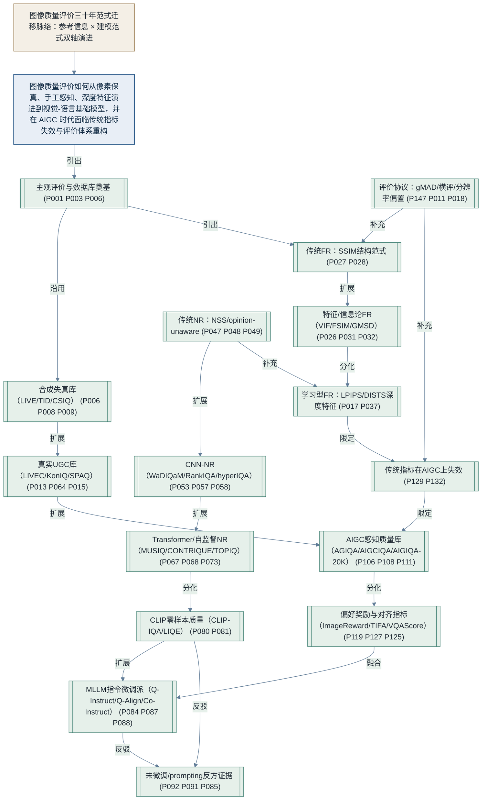

# 04 核心逻辑图：IQA 三十年范式迁移脉络

> 本图为研究脉络图（research lineage graph），由 doubao-academic-researcher 管线的 research_visuals.py 从 `.workflow/research_visuals.json` 自动生成，节点证据编号（P001…）对应 `03_文献库_核验清单` 中的文献编号；节点间带语义标签的有向边（引出/扩展/分化/融合/反驳/限定/沿用）表示流派之间的真实关系。
> 图的 Mermaid 源码同时保存于：`.workflow/figures/logic_graph.mmd`（项目 work 目录下另有一份）；飞书白板 XML 为 `.workflow/figures/logic_graph.whiteboard.xml`（投稿时用 Mermaid Live Editor 或 mermaid-cli 导出 300 dpi 以上 PNG/PDF）。

## 读图说明

- **根节点**：IQA 如何从像素保真、手工感知、深度特征演进到视觉-语言基础模型，并在 AIGC 时代面临传统指标失效与评价体系重构。
- **横向脉络**：主观/数据库奠基 → 合成失真库与真实 UGC 库 → 传统 FR 结构范式与特征/信息论指标 → 学习型 FR → NSS 无参考 → CNN 监督 → Transformer/自监督 → CLIP 零样本 → MLLM 指令微调与 MLLM-as-Judge → AIGC 数据库 → 偏好奖励模型/对齐指标 → 评价协议。
- **关键关系边**：NSS→CNN→Transformer→CLIP/MLLM 为「扩展/分化」；传统 FR 指标到 AIGC 评价为「限定」（ImagenHub 实测 Spearman<0.2）；MLLM 微调派与未微调派之间为「反驳」；MLLM 评判与偏好奖励模型在 AIGC 上「融合」。

## Mermaid 源码（可直接粘贴到 Mermaid Live Editor / 飞书白板）

## 终稿投稿建议

1. 学报要求图 300 dpi 以上、中英文对照图题：导出 PDF 或高分辨率 PNG，图题建议为「图 1 图像质量评价研究脉络核心逻辑图 / Core logic graph of IQA research lineage」。
2. 飞书云文档中该图以 `<whiteboard type="mermaid">` 白板形式插入，位置在「四、研究视角与本文结构」之后、「六、主题章节」之前。
3. 若需调整节点（如终稿增删文献），改 `.workflow/research_visuals.json` 后重跑 `python scripts/research_visuals.py --input .workflow/research_visuals.json --output-dir .workflow/figures`。
